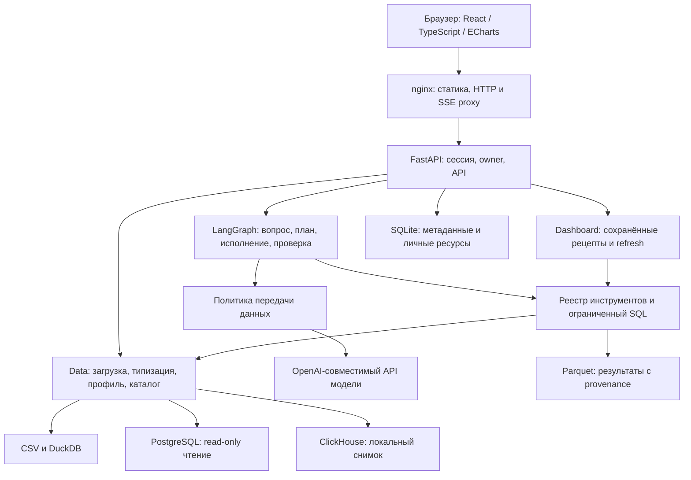

# Архитектура DjedAI

Материалы к сдаче 31.10.2026. Проверяемая ревизия приложения —
`a32c15cffd160c345d99b15e358d1bd00e9fc734`. На ней завершены 18 live-запусков шести вопросов:
автопроверки — 15/18, независимая смысловая оценка — 14 корректных, 2 частичных,
1 отказ публикации и 1 инфраструктурный сбой без смысловой оценки.
Исходные результаты — [organizer.json](eval/reports/final-20261031-a32c15c/organizer.json),
смысловая оценка — [organizer-semantic-review.json](eval/reports/final-20261031-a32c15c/organizer-semantic-review.json),
происхождение данных и конфигурация — [provenance.json](eval/reports/final-20261031-a32c15c/provenance.json).
Границы проверок — в [Criteria.md](Criteria.md), подробности шести вопросов и отдельного
recovery — в [TestCases.md](TestCases.md). Браузер и видео этими запусками не проверены.

DjedAI принимает CSV или подключение к PostgreSQL/ClickHouse. Пользователь задаёт
вопрос в чате; агент выбирает инструменты, backend выполняет вычисления и сохраняет
результат. Браузер показывает текст, таблицу или график. График можно сохранить
в личный дашборд и позднее пересчитать без открытого чата.

## Компоненты и стек

| Слой | Реализация | Назначение |
| --- | --- | --- |
| Интерфейс | React, TypeScript, Vite, ECharts | Чат, каталог, источники, графики, дашборды; HTTP и fetch SSE |
| API | Python 3.13.16, FastAPI, SQLAlchemy, Alembic | Авторизация, очередь ходов, хранение, доступ по владельцу |
| Данные | DuckDB, pandas, NumPy | Сохранённый raw, типизированные представления, статистический каталог |
| Аналитика | SQLGlot, SciPy, statsmodels | Проверка SQL, агрегаты, аномалии, сегменты, корреляции, прогноз |
| Агент | LangGraph, Pydantic, модельный клиент | Типизированные стадии, инструменты, память и верификация |
| Хранение | SQLite, DuckDB, Parquet, JSONL | Метаданные, источники, результаты, диагностика |
| Поставка | Docker Compose, nginx | Одна backend-реплика и frontend; постоянный том `app-data` |

Точные версии зависимостей закреплены в [uv.lock](uv.lock) и
[frontend/package-lock.json](frontend/package-lock.json), образы — в
[compose.yaml](compose.yaml) и Dockerfile в [infra](infra/).
Прогоны из [Criteria.md](Criteria.md) выполнены на DeepInfra `Qwen/Qwen3.6-27B`, эта же модель
указана по умолчанию в `.env.example`; параметры и ограничения измерений приведены в [конфигурации](docs/administrator/configuration.md#профиль-организаторов-pl-9).
Compose не разворачивает сервер модели. Для сервера организаторов задаются URL,
ID модели и ключ; совместимость этого конкретного сервера ещё нужно подтвердить.

## Путь данных и ответа

1. Backend проверяет сессию и владельца источника. CSV сохраняется без перезаписи
   исходных значений; типизация создаёт отдельное представление с журналом преобразований.
   PostgreSQL читается через ограниченное подключение, ClickHouse материализуется
   в локальный снимок с лимитами объёма и времени.
2. Профайлер строит каталог: таблицы, колонки, типы, статистику, связи и предупреждения.
   Описания модели опциональны; они отделены от вычисленного профиля.
3. Граф получает вопрос, каталог и контекст своего чата. Неоднозначность ведёт
   к уточнению; обычный путь — понимание, план, инструменты, визуализация, текст и проверка.
4. Инструменты работают в серверном scope. Модель не назначает владельца и не получает
   произвольный доступ к БД, файлам или сети. SQL проходит проверку read-only политики.
5. Результаты сохраняются с `result_id`, параметрами и происхождением. Перед публикацией
   числа ответа проверяются двумя способами: детерминированным кодом
   ([verification.py](src/djedai/agent/verification.py)) по фактам и данным результатов хода
   и отдельным вызовом модели. Отклонённый черновик получает ограниченную попытку
   исправления; если подтверждённый текст не получен, ответ заменяется отказом. Итог
   сохраняется в отчёте вместе с сообщением. Это не гарантия правильности любого вывода модели.

   **Сознательное ослабление [решения #167](docs/decisions/167-numeric-verification.md)
   (коммит `10ab791`).** Спорная подпись числа больше не блокирует ответ, если само число
   есть в результатах хода, а агрегат с подписью не спорит. Утверждение получает статус
   `ignored`, причина остаётся в отчёте. Поэтому верное число может выйти с неверной
   подписью. Блокируют по-прежнему число вне результатов, конфликт агрегата,
   валюта, единица и период. Причина изменения — ложные отказы на правильных ответах.
6. Backend публикует блоки ответа и события SSE. `ChartSpec` ссылается на сохранённый
   результат; браузер получает значения через API, а не из сгенерированного кода.

Дашборд имеет отдельную ветку планирования. Виджеты хранят воспроизводимые рецепты;
refresh выполняет инструменты без нового обращения к модели и создаёт новые результаты.
Ошибка одного виджета показывается отдельно от успешных соседних вычислений.

## Хранение и границы доверия

В томе `app-data` находятся SQLite (`/app/var/app.db`), датасеты, результаты Parquet
и диагностика. История и определения дашбордов сохраняются между перезапусками.
Резервная копия включает весь том; внешняя PostgreSQL в неё не входит. Для восстановления
зашифрованных подключений нужен прежний `SOURCE_ENCRYPTION_KEY`.

Пароли хешируются Argon2id. Сессия использует непрозрачный Bearer token; сервер хранит
его verifier. API проверяет владельца датасетов, чатов, результатов и дашбордов.
Общие Pydantic-контракты служат источником схем API и генерируемых TypeScript-типов.

Модель получает контекст через единую политику передачи данных. Даже при
`ALLOW_DATA_SHARING=false` разрешённые факты и значения текущего результата могут
уходить провайдеру. `ALLOWED_OUTBOUND_HOSTS` не реализует сетевой firewall.
Требования локальности, лицензий и сети отдельно оценены как T9–T11 в [Criteria.md](Criteria.md).

## Причины решений и ограничения

SQLite и локальные файлы упрощают поставку на одну машину. DuckDB выполняет локальную
аналитику, а сохранённые результаты позволяют повторно открыть ответ и проверить SQL.
Декларативные графики и общие контракты ограничивают формат ответа модели.
Рецепт дашборда отделяет повторный расчёт от неповторяемого диалога с LLM.

Текущая поставка рассчитана на одну backend-реплику. SQLite и файлы не образуют общей
транзакции; несколько реплик потребуют общего хранилища, очередей и координации.
Каталог PostgreSQL может устареть; снимок ClickHouse обновляется отдельно.
Ограничение времени не позволяет безопасно остановить любой синхронный Python/C-код.
Для многопользовательской сетевой установки дополнительно нужны TLS, сетевые правила
и проверка нагрузки. Эти расширения не заявлены как реализованная часть поставки.

Подробности: [архитектура](docs/developer/architecture.md), [агент](docs/developer/agent.md),
[аналитика](docs/developer/analytics.md), [API](docs/developer/api.md), [эксплуатация](docs/administrator/operations.md).
Начало работы — [README](README.md) и [локальная сборка](docs/administrator/local-build.md).
