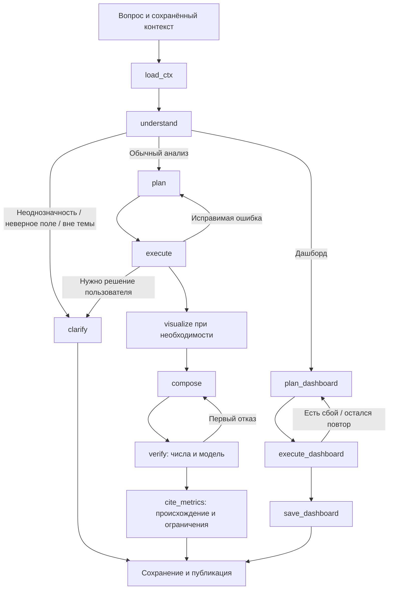

# Агент: вопрос, вычисление и ответ

Агент DjedAI связывает вопрос пользователя с каталогом, аналитическими инструментами и сохранёнными результатами. Модель понимает формулировку, составляет типизированный план и объясняет вычисленные данные. Backend задаёт владельца, датасет, доступные источники, сроки и правила сохранения; модель не управляет правами доступа.

Эта глава описывает исполнение обычного вопроса, память, графики, дашборды и сетевые границы. Действия пользователя — в [руководстве](user-guide.md), вычисления — в [аналитике](analytics.md), источник и ревизии — в [данных и каталоге](data-and-catalog.md), HTTP/SSE — в [API](api.md).

## Две ветки исполнения

Граф реализован в [graph.py](../src/djedai/agent/graph.py), внутренние схемы — в [contracts/agent.py](../src/djedai/contracts/agent.py), prompts — в [prompts](../prompts). Перед выполнением backend проверяет сессию, владельца чата и датасета, создаёт реальный model runtime и защищённый dataset context.

Обычный численный вопрос обычно требует четырёх последовательных LLM-стадий: understand, plan, compose, verify. Визуализация добавляет отдельный вызов, повторный план или исправление текста — дополнительные. Скорость одного COUNT в DuckDB поэтому не является скоростью ответа целиком. Случаи неоднозначности могут завершиться раньше, запросом уточнения.

## Загрузка контекста

`load_ctx` получает `DatasetCatalog`, очищает его по общей политике и строит компактный prompt. Если доступен сервис метрик, добавляет подтверждённые определения и явно отмечает отсутствие определения. На каждый ход сбрасываются результаты текущего вычисления, графики, блоки ответа и счётчики повторов; прошлые результаты остаются отдельной историей.

Контекст backend включает последние сообщения, краткую историю старой части, результаты из недавних ответов, фокус разговора и структуру предыдущего ответа. Идентификаторы результатов загружаются с проверкой owner/chat/dataset и provenance. Чужой либо недоступный ID не становится входом только потому, что модель упомянула его в тексте.

## Понимание и уточнение

`understand` возвращает `Understanding`: intent, `resolved_question`, таблицы/поля, references и возможное уточнение с вариантами. Основные intents: обзор, вопрос по данным, визуализация, изменение предыдущего ответа, гипотеза, дашборд, неоднозначный/некорректный/посторонний запрос.

`resolved_question` позволяет связать «а теперь по месяцам» с прежней метрикой и периодом. References должны указывать на известные результаты. Смысловое соответствие остаётся работой модели: Pydantic проверяет структуру, а не доказывает правильность intent или выбора поля.

При неоднозначной метрике агент должен спросить о смысле: gross/net, возвраты, валюта, знаменатель отношения. Он может предложить структурированный кандидат определения. Backend сверяет кандидата с каталогом; лишь выбор пользователя подтверждает его через сервис метрик. Неподтверждённое предложение и описание LLM сами метрику не утверждают.

`clarify` не вызывает модель заново. Он формирует отдельный блок с вопросом и `options`, которые интерфейс отображает кнопками. Для ошибок метрик и blocking-ограничений качества также создаётся уточнение. При отсутствии вариантов остаётся текстовый вопрос. Сообщения и варианты очищаются от секретов перед публикацией.

Ответ на вариант уточнения относится к текущему вопросу. Для последовательных решений по качеству backend объединяет исходный вопрос с выбранными вариантами; формат каталога этим не меняется. Пустой HTTP-вопрос отклоняется на входной границе без вызова модели; дополнительный short-circuit пустого сообщения есть и внутри графа.

## План и инструменты

`plan` получает каталог, память, определения зарегистрированных инструментов и очищенные исходы прежних попыток. Результат — список `PlannedCall(tool,args)` длиной не более пяти шагов. Шаги исполняются последовательно.

Инструменты и SQL выполняются на backend. Модель не может передать произвольный connection, trusted scope или изменить конфигурационный лимит через args. Registry валидирует параметры; runtime проверяет допустимые таблицы, SQL и подтверждённые метрики. Подробнее — [границы аналитики](analytics.md#sql-и-границы-доступа).

После ошибки инструментов обычный план можно переписать ещё два раза: всего до трёх серий. Та же серия тратится один раз, когда план только посмотрел значения колонок (`value_counts`, `describe_column`): следующий план получает их как результат текущего хода и пишет расчёт либо возвращается пустым, если их уже достаточно. Пять шагов — предел одного плана, а не всего хода. Все серии используют общий deadline. Ошибки `compute_metric`, требующие решения пользователя, сразу ведут в уточнение; тот же отказ `run_sql` сначала даёт шанс перепланировать вызов на `compute_metric`.

Результаты разных серий сохраняются с отдельными IDs. Успешный ранний результат не становится автоматически доказательством, что весь последний план выполнен. При трактовке ответа важны фактические исходы и ссылки опубликованных блоков.

## Память диалога и смена представления

Память состоит из сохраняемых SQLite-данных и контекста, собираемого для каждого хода. LangGraph `MemorySaver` помогает во время работы процесса; восстановление после перезапуска опирается на backend storage.

| Элемент | Текущее поведение |
| --- | --- |
| Недавняя история | Последние10 сообщений чата |
| Summary старой части | Детерминированные фрагменты реплик, до2000 символов, без отдельного LLM-вызова |
| Фокус | IDs успешных результатов, о которых сейчас идёт разговор |
| Previous blocks | Структура предыдущего ответа для ссылок «второй график», «эта таблица» |
| Исторические результаты | Загружаются из storage с owner/chat/dataset-проверками |
| Выборки прошлых результатов | Зависит от политики передачи данных |

Summary — ограниченное текстовое сжатие, а не полная долговременная семантическая память. Старые подробности могут быть потеряны. `MODEL_CONTEXT_TOKENS=8192` задаёт рабочий бюджет конфигурации, но автоматической токенной укладки всего каталога и истории в это окно нет.

Фокус может пережить окно сообщений: backend отдельно загружает сохранённые focus IDs, даже когда породивший их ответ уже старше последних10 реплик. Удалённые и недоступные результаты из фокуса исключаются. Для новой успешной серии фокус обновляется; иначе используются проверенные references или прежний фокус.

Просьба «покажи это столбцами» может переиспользовать сохранённый результат без нового SQL. Для графика сначала берутся успешные результаты текущего хода, затем явные references, фокус и допустимый fallback истории. Compose/verify получают факты именно этих выбранных результатов. Новый расчёт по живой PostgreSQL читает источник заново; изменение представления сохранённого результата сохраняет его прежние числа и происхождение.

Просьба открыть или обновить ранее созданную панель распознаётся в `understand`: из блоков предыдущего ответа берётся `dashboard_id`, а не придумывается моделью. Ветка `refresh_dashboard` пересчитывает рецепты через backend-сервис, сохраняет новые результаты и возвращает ссылку на ту же панель. Чужой, удалённый или неизвестный ID даёт явную ошибку без выдачи старого снимка за свежий.

При продолжении без нового расчёта runner golden-набора разрешает подтверждать факты результатом явно названной предпосылки (`reuse_result_from`), только если все ожидаемые факты совпали; отчёт сохраняет источник проверки. Это проверка прогонщика, а не расширение доступа модели: политика передачи данных для прошлых выборок не меняется.

Память реализована в [memory.py](../src/djedai/agent/memory.py) и [chat_service.py](../src/djedai/backend/chat_service.py). Переиспользование результата для объяснения/графика не означает поддержку произвольного обычного tool-call с `source_result_id`: такая зависимость исполняется отдельно в дашбордах.

## Графики

`visualize` вызывается с моделью, когда intent либо слова вопроса показывают явную потребность в графике. Для обычного текста без такого запроса сетевой вызов выбора графика пропускается.

Модель получает разрешённое описание существующих результатов: result ID, колонки, объём, facts, chart_hint и допустимые sample rows. Она возвращает `VisualizeResponse` с `ChartSpec`. Спецификация ссылается на сохранённый result ID; данные не зашиваются в произвольный исполняемый код графика.

Контракт поддерживает line, bar, area, scatter, pie, histogram, heatmap, box, table и kpi; оси имеют виды time/category/number. Y задаёт поля и формат number/money/percent/int; отдельно доступны цвет, сортировка, лимит, подписи и аннотации. Реальный renderer дополнительно проверяет свою форму данных — наличие имени типа в контракте само по себе не доказывает содержательную корректность любой спецификации.

`sanitize_charts` проверяет:

- существует ли результат и есть ли его данные;
- существуют ли поля X/Y/color/sort;
- числовые ли Y и числовая X для scatter/number;
- уникальность chart ID, исправляя пустые/повторные IDs.

Несовместимая спецификация отбрасывается. Если тип колонки отсутствует, числовость оценивается по доступным значениям; при полном отсутствии данных знание о типе ограничено. Валидная схема и sanitizer не доказывают правильность выбора масштаба, единиц, всех подписей или статистической интерпретации.

`ChartSpec.limit` по умолчанию20 — отдельный предел показа, не SQL-агрегация. Для полного ряда из24 месяцев нужно сохранить все24 точки в результате и запросить соответствующий лимит. Усечённый ряд нельзя выдавать за полный. Контракт — [chart.py](../src/djedai/contracts/chart.py), renderer — в [frontend](frontend.md) и [описании графиков](chart-renderer.md).

## Compose и проверка перед публикацией

`compose` получает разрешённые факты и строки выбранных успешных результатов с их IDs. Prompt требует опираться на вычисления, сохранять единицы, популяцию и ограничения. Backend не публикует этот draft немедленно: обычная ветка сначала проходит `verify`.

Текущее поведение `verify`:

1. Собирает текстовые markdown-блоки и title/subtitle графиков.
2. Если проверяемого текста нет, завершает без модельного вызова.
3. Если нет фактов/данных выбранных результатов, заменяет текст сообщением об отсутствии данных.
4. Если политика оставила недостаточно разрешённого контекста, удаляет текст/графики и возвращает ограничение.
5. Иначе детерминированно проверяет числа черновика по разрешённым фактам и данным ([verification.py](../src/djedai/agent/verification.py)) и отдельно вызывает ту же модель, ожидая `VerifyResponse(is_valid,issues,corrected_markdown)`.
6. Если проверка не пройдена и попытки остались, возвращается в compose.
7. Если подтверждённый текст получить не удалось, ответ с неподтверждённым числом может быть заменён отказом.
8. При ошибке API/политики удаляет неподтверждённые text/chart-блоки и возвращает ошибку.

Итог проверки сохраняется вместе с сообщением в отчёте `VerificationReport`. Аннотации графиков не входят в собранный title/subtitle draft.

**Детерминированная проверка не доказывает смысл ответа целиком:** она не заменяет независимый расчёт и оценку вывода человеком. Контракт и границы — [решение #167](decisions/167-numeric-verification.md).

После verify обычная ветка выполняет `cite_metrics`: детерминированно добавляет «Как посчитано» для подтверждённых метрик и чтений, а также «Ограничения данных» из качества/свежести. Эти пояснения опираются на `ToolResult.metric`, `.quality`, `.read`, а не на свободное решение LLM. Дашборд использует отдельную ветку ниже и не проходит этот цикл compose/verify.

## Отдельная ветка дашборда

Intent dashboard направляется в `plan_dashboard → execute_dashboard → save_dashboard`. План обычного анализа на пять шагов здесь не используется. Если вопрос явно ссылается на уже сохранённую панель, `understand` возвращает её `dashboard_id`, и граф идёт в `refresh_dashboard → END`: сервис перевыполняет рецепты всех виджетов, получает новые `result_id` и сохраняет тот же dashboard. Модель не выбирает dashboard по названию на глаз и не создаёт вторую панель вместо обновления.

| Ограничение | Значение |
| --- | --- |
| Виджеты | От3 до8 |
| Шаги виджета | От1 до5 |
| Сумма шагов плана | `DASHBOARD_MAX_TOOL_CALLS`, по умолчанию20 |
| Модельный вывод плана | `DASHBOARD_MAX_OUTPUT_TOKENS`, по умолчанию4096 |
| Повтор полного плана | Один, если хотя бы один виджет не рассчитан |

Планировщик видит `run_sql` и `compute_metric`. Каждому виджету задаются title, chart template, шаги и выходной шаг. `normalize_dashboard_plan` проверяет размеры, уникальность и порядок зависимостей; ID шагов приводятся к `step_1`, `step_2` внутри виджета. Ссылаться можно только на предыдущий шаг того же виджета.

Родительский результат передаётся dispatcher отдельно и на время дочернего вызова регистрируется как `source_result`. Его чувствительные выходные колонки остаются чувствительными даже после нейтрального SQL alias. Усечённый/недоступный родитель даёт `dependency_truncated`/`dependency_failed`; вычисление по неполным строкам не выполняется.

У независимого виджета сохраняется `WidgetToolCall`, у многошагового — `WidgetRecipe` со стабильными `source_step_id` и `output_step_id`. Временные result UUID в recipe params не сохраняются. После выполнения конкретные результаты всё равно имеют `source_result_id` для provenance.

Если один виджет не рассчитан, модель получает ошибки и один раз перепланирует весь дашборд. Общий deadline сохраняется, а ограничение20 шагов проверяется на каждом плане/его исполнении. После повторной неудачи сохраняется частичный дашборд с явными ошибками; успешные соседи остаются доступны. Сбой самого plan или недоступное сохранение даёт ошибку вместо готовой ссылки.

Chart template проверяется по фактическим колонкам результата; при несовместимости строится допустимый fallback. Ответ содержит ссылку на сохранённый dashboard и превью успешных виджетов. Эта ветка заканчивается после сохранения и **не выполняет обычные compose/verify/cite_metrics**. Поэтому её подписи и выводы нельзя описывать как прошедшие ту же модельную проверку, что текст обычного анализа.

Открытие дашборда читает сохранённый снимок. Явный refresh без LLM повторяет tool-call/recipe, получает новые result IDs и использует новый родительский результат для каждого зависимого шага. Старые временные результаты для воспроизведения не нужны. Ошибка виджета даёт `status="error"`, `result_id=null`; старые данные не выдаются за свежие. PostgreSQL-виджеты пытаются разделить один снимок чтения; потеря транзакции отражается в consistency.

Точное устройство — [dashboard.py](../src/djedai/agent/dashboard.py), [решение о ветке](decisions/78-dashboard-branch.md), [Dashboard API/refresh](decisions/97-dashboard-api-refresh.md) и [dashboard_service.py](../src/djedai/backend/dashboard_service.py).

## Передача данных модели

Внешний инференс использует OpenAI-compatible API. Все стадии и описания каталога разделяют один `DataTransferPolicy`, связанный с `BIModelClient`. Финальный guard срабатывает перед первой сетевой попыткой; retry/repair используют уже очищенные prompts.

| Данные | Режим по умолчанию `ALLOW_DATA_SHARING=false` | `true` |
| --- | --- | --- |
| Метаданные, описания, связи, разрешённая статистика | Передаются | Передаются |
| Вопрос, текст истории, summary | Передаются после очистки | Передаются после очистки |
| Структурированные факты и агрегаты | Передаются после очистки | Передаются после очистки |
| Строки текущего результата | Разрешены после очистки | Разрешены после очистки |
| Примеры/top-values каталога | Исключены | Дополнительно разрешены |
| Сырые строки прошлых результатов | Исключены; остаются метаданные/факты | Дополнительно разрешены |
| Секреты, DSN, пароли, ключи, токены | Запрещены | Запрещены |

Таким образом, false не означает отсутствие передачи значений во внешний API: текущий результат нужен для объяснения. При работе с данными учитывайте endpoint и эти категории. Полный режим предназначен для доверенного получателя и дополнительно раскрывает примеры/исторические строки.

Очистка учитывает исходные имена колонок после slugify, секретные поля в структурах/JSON, credentials в URL/DSN, Bearer и ключи. Для SQL чувствительность выходной колонки прослеживается через aliases, CTE, подзапросы и UNION. Факты также очищаются по происхождению, а не считаются безопасными только из-за поля `facts`. У чувствительных колонок каталога удаляются sample/top/min/max и производные статистики. Summary и история очищаются до обрезки, чтобы усечение не разорвало секретный блок.

Если разрешённых фактов и строк недостаточно для ответа, compose/verify не вызывают модель для выдумывания недостающих значений: возвращается понятное ограничение. Политика дополняет авторизацию и dataset scope; она не заменяет их и не является универсальной классификацией всех видов персональных данных.

Разрешение sharing, reasoning и тариф относятся к подтверждённой паре endpoint+model. При выборе другой пары через настройки клиента применяется restricted data policy и provider_default reasoning; прежнее разрешение не переносится автоматически. Подробности — [решение о политике](decisions/173-data-transfer-policy.md), [data_policy.py](../src/djedai/agent/data_policy.py), [agent/config.py](../src/djedai/agent/config.py).

## Модель, схемы и reasoning

`BIModelClient` запрашивает strict JSON Schema, затем повторно валидирует JSON через Pydantic. Невалидный JSON, несовместимая схема и `finish_reason=length` дают отдельные ошибки; обрезанный вывод не считается частичным успехом. Пользовательские ошибки не содержат raw provider response или prompts.

Default приложения: temperature0.1, output2048 tokens, рабочий context8192. Согласованный профиль модели и старые измерения находятся в [model-profile-pl1.md](archive/model-profile-pl1.md). Модель/endpoint/key задаются конфигурацией и разрешёнными настройками установки; отсутствие реального клиента не заменяется демонстрационным успешным ответом в production.

Reasoning задаётся отдельно для understand, plan, visualize, compose, verify: `provider_default`, `none`, `low`, `medium`, `high`. `provider_default` вообще не отправляет параметр; это рабочий default всех стадий. Явный режим требует `MODEL_REASONING_SUPPORTED=true` для выбранной пары. Неподдержанная конфигурация возвращает понятную ошибку, а не молчаливое игнорирование. Dashboard план использует стадию plan; descriptions без stage остаются на поведении провайдера.

Возможность настройки не доказывает, что ускоренный профиль уже безопаснее или быстрее. Для выбора нужны повторные сравнения полного пути, схемы, смысла и независимых числовых ожиданий. Синтетический A/B checker и реальная свободная оценка агента — разные уровни; см. [quality.md](quality.md) и [контракт benchmark](decisions/159-benchmark-validation.md).

Для стандартного HTTPS Chat Completions endpoint DeepInfra транспорт сжимает JSON от 4096 байт, когда gzip уменьшает тело. Другие адреса, маленькие или уже закодированные запросы передаются без изменения. Сжатие учитывает бюджет/отмену, не меняет промпт, политику данных и число токенов; это оптимизация сетевого объёма, а не стоимости inference. Условия — [конфигурация](configuration.md#сжатие-http-запросов-213), реализация — [transport.py](../src/djedai/agent/transport.py).

## Deadline, retry и отмена

Один явно отправленный вопрос получает общий монотонный бюджет. Он начинается после проверки доступа и создания runtime, затем охватывает контекст, граф, инструменты, сетевые попытки, паузы и сохранение ответа. Очередь допуска имеет отдельные лимиты; подробности — [операции](operations.md).

| Настройка | Default |
| --- | --- |
| `AGENT_TURN_TIMEOUT_SECONDS` | 120с на ход |
| `MODEL_TIMEOUT_SECONDS` | 60с на одну попытку, не больше остатка хода |
| `MODEL_MAX_RETRIES` | Один дополнительный запрос |
| `MODEL_RETRY_DELAY_SECONDS` | 0.5с, затем экспоненциальный рост |
| SDK retries | Отключены:0 |

Повторяются network/timeout и HTTP408/429/500/502/503/504. Постоянные401/403, ошибки схемы/JSON и неверная конфигурация сетевого retry не получают. `retry-after-ms`, Retry-After seconds/date имеют приоритет; если пауза не помещается в остаток, ранняя новая попытка не начинается. HTTP error status/headers обрабатываются сразу без чтения медленного тела ошибки.

При deadline отправляется один терминальный `error` с `turn_timeout`, без последующего `done`. При отмене интерфейс сохраняет отмену конкретного сообщения и закрывает fetch; disconnect/отзыв сессии также останавливают ход. Активный HTTP-запрос отменяется с закрытием ответа/сокета. Проверки перед записью и публикацией не дают позднему draft превратиться в успешный assistant после окончания хода.

SQLite-запись assistant использует короткую budgeted-транзакцию: `busy_timeout=0`, повторы только BUSY/LOCKED в пределах бюджета, повторная проверка после flush перед commit и rollback при отмене. Позднее снятие блокировки не сохраняет отменённый старый ответ. Произвольный синхронный CPU/I/O стороннего инструмента всё равно не получает жёсткой остановки потока; расширения должны проверять `current_budget` при длительной работе.

Механизм ограничивает ожидание, а не ускоряет модель. Более медленный корректный ответ тоже может быть прерван. Подробности, допустимые диапазоны и управляемые проверки — [agent-deadlines.md](agent-deadlines.md), [client.py](../src/djedai/agent/client.py), [transport.py](../src/djedai/agent/transport.py), [execution.py](../src/djedai/execution.py).

## Сохранение и публикация

Backend получает updates графа, сохраняет `ToolResult`, затем собирает окончательные блоки после завершения выбранной ветки. В обычной ветке verify успевает заменить или удалить draft до публикации. Текст не стримится пользователю токенами.

SSE передаёт статусы стадий/повторов, tool-call/result и готовые блоки. Событие `tool_call` формируется при разборе execute-update и не гарантирует отправку до фактического начала SQL. Статусы/терминальное состояние хода сохраняются отдельно; после перезагрузки клиент может восстановить исход принятого вопроса. HTTP200 открытого SSE не означает успешный ответ агента.

Публичные блоки — текст, таблица, график, уточнение, предложения и ссылка на dashboard. Ссылки на результаты проверяются по владельцу, датасету и чату; произвольный result ID из модели не публикуется как доступный. Внутренний error преобразуется в терминальную SSE-ошибку. Детали wire-формата — [api.md](api.md), [chat-turns.md](chat-turns.md), [chat-blocks.md](chat-blocks.md).

## Диагностика и проверенность

Каждый ход имеет run ID, записи стадий, модельных вызовов и реальных сетевых попыток. Журнал различает success/error/timeout/cancelled, длительности, модель, схему, reasoning setting и доступный usage. Неизвестные tokens обозначаются null. В диагноз не записываются prompts, ответы, значения строк, ключи, DSN и raw exceptions провайдера.

При полном usage и вручную заданном тарифе рассчитывается оценка `(input_tokens×input_rate + output_tokens×output_rate)/1e6`; actual charge остаётся неизвестным. Ошибка без usage не объявляется бесплатной. Файл JSONL ротируется и сохраняется в volume, оператор читает его CLI. Эксплуатационные команды — в [operations.md](operations.md), формат — в [agent-diagnostics.md](agent-diagnostics.md).

Реализация проверяется на нескольких уровнях: unit графа/памяти/политики/клиента, интеграция защищённого runtime и persistence, управляемый HTTP transport, browser/Compose и отдельные реальные модельные прогоны. Эти доказательства нельзя подменять друг другом. Наличие golden questions, runner или зелёного fake-model теста не означает прохождение всех свободных сценариев реальной моделью. Актуальная методика и ограничения — в [качестве проекта](quality.md).
