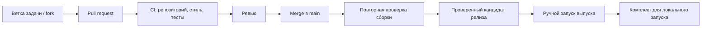

# План внедрения CI/CD в DjedAI

Подготовлено 15 октября 2026 года. Это план для обсуждения и последующей реализации через отдельные PR. Workflows, окружения и настройки защиты веток этим документом не создаются.

Основание: [соглашение команды](../CONTRIBUTING.md), [спецификация](specification.md), [согласованный план задач](issues-plan.md) и фактический каркас репозитория.

## 1. Зачем нужен процесс

CI должен показывать, что изменение совместимо с проектом, воспроизводится из зафиксированных зависимостей и проходит нужные проверки до попадания в `main`.

Для первого варианта CD предлагается **continuous delivery**: подготовка проверенного комплекта для локального запуска и демонстрации. Развёртывание на конкретном сервере требует отдельного решения о целевой машине и доступах. Автоматическая выкладка каждого изменения в работающую демонстрационную среду не предполагается.



## 2. Что уже есть и чего пока нет

На момент проверки:

- Есть один стартовый коммит с каталогами, документацией и образцом окружения.
- GitHub Actions разрешены, но workflows отсутствуют.
- `main` пока не защищён настройками GitHub; правило работы через PR записано в соглашении.
- Нет `pyproject.toml`, `uv.lock`, точной версии Python, кода приложения, тестов, Dockerfile и Compose.
- Основной продукт должен запускаться локально; модель и пользовательские данные не должны становиться зависимыми от облачной среды CI.

Поэтому проверки включаются по мере готовности реальных компонентов. Существование каталога `tests/` или README не считается успешным тестированием приложения.

## 3. Предлагаемые инструменты и общие правила

Для оркестрации — GitHub Actions. Для Python — uv, Ruff, pytest и pytest-cov, уже предусмотренные соглашением. На старте достаточно одного согласованного Python и Linux для основных проверок; Windows-проверки добавляем для затронутой платформенной логики, без матрицы всех версий Python.

Точные версии Python, uv и библиотек выбираются при подготовке окружения. Actions фиксируются полным commit SHA, внешние образы — согласованной версией/digest. Использование action для установки uv и чтение Python из `.python-version` поддержаны [официальной интеграцией uv](https://docs.astral.sh/uv/guides/integration/github/).

В CI используем `uv sync --locked` и `uv run --locked …`. Несоответствие lock-файла декларациям должно приводить к ошибке, а не к обновлению зависимостей в процессе проверки. [Режим locked](https://docs.astral.sh/uv/concepts/projects/sync/).

На первом этапе проверки работают с синтетикой. Использование GitHub-hosted runners для разработки нужно сверить с трактовкой условий кейса: в спецификации ограничены облачные решения и исходящие обращения. Если ограничение распространяется и на сборочную инфраструктуру, те же проверки выполняем в согласованной изолированной локальной среде. Наличие GitHub-репозитория само по себе не снимает это ограничение.

## 4. Порядок внедрения

| Этап | Что получаем | Когда начинать | Как принимаем |
|---|---|---|---|
| 1. Проверки репозитория | Первый работающий CI без установки приложения | Можно сейчас | Проходят корректные документы; сломанная локальная ссылка и лишний отслеживаемый `.env` обнаруживаются |
| 2. Python CI | Проверка зависимостей, стиля и unit-тестов с покрытием | Вместе с Python-каркасом, версиями и первыми настоящими тестами | Намеренно внесённые ошибка стиля, падение теста, рассинхронизация lock и покрытие ниже 80% блокируют проверку |
| 3. Интеграции и сборка | Проверенные API/БД, миграции, образы и локальный запуск | По мере появления компонентов и Dockerfile/Compose | Временные БД, контроль доступа, сохранение и сборка проверяются воспроизводимо |
| 4. Оценка модели | Отдельный управляемый прогон качества и GPU-интеграции | После модели и eval-прогонщика | Есть отчёт по зафиксированной версии кода, модели и набора вопросов; пропуски не считаются успехом |
| 5. Выпуск | Проверенный и идентифицируемый комплект локального запуска | После рабочей сборки и приёмки кандидата | Другой участник запускает конкретный релиз по инструкции; известны ограничения и способ возврата к прошлой версии |

Этапы — небольшие последовательные PR, а не одна большая задача до финала. GPU-прогоны могут развиваться параллельно CPU-интеграциям.

## 5. Этап 1: что проверяем уже на каркасе

Будущий `.github/workflows/ci.yml` запускается на PR в `main` и на изменения `main` после merge. Проверки документации и структуры используют обычные средства runner, без установки библиотек приложения.

- Наличие входного README, соглашения, образца окружения и основных каталогов.
- Локальные ссылки в Markdown, корректность UTF-8 и существенные ошибки формата файлов.
- Отсутствие отслеживаемых `.env`, виртуальных окружений, весов и локальных результатов; проверяется индекс/состав коммита, а не только наличие записей в `.gitignore`.
- Осмысленный отчёт: «проверен каркас; Python CI ещё не подключён», пока в проекте нет Python-кода.

Не вводим глобальный запрет слов `password`/`secret`: в документации и безопасном образце они допустимы. Проверка наличия секретов не должна выдавать себя за доказательство отсутствия любых утечек.

Если появляется собственный Python-код без необходимых метаданных, lock-файла или тестов, CI сообщает о неполной настройке. Нельзя автоматически объявлять проверку успешной лишь потому, что конфигурация ещё отсутствует.

## 6. Этап 2: обязательные проверки Python

Вход: согласованная версия Python, `pyproject.toml`, `uv.lock`, dev-зависимости, настройки Ruff/pytest/coverage и первые тесты. Состав dev-группы и команды совпадают локально и в CI.

Предлагаемые jobs:

| Job | Что делает |
|---|---|
| `repository` | Выполняет проверки этапа 1 |
| `quality` | Проверяет согласованность окружения, точные прямые версии библиотек, Ruff check и Ruff format |
| `unit` | Выполняет быстрые тесты без GPU/сети и проверяет порог покрытия |
| `required` | Всегда формирует общий результат всех проверок, обязательных для текущего этапа |

Базовые команды после появления окружения:

```sh
uv sync --locked
uv run --locked ruff check .
uv run --locked ruff format --check .
uv run --locked pytest -m "not integration and not llm" --cov --cov-config=pyproject.toml --cov-report=term-missing --cov-report=xml --cov-fail-under=80
```

Порог — **80% строк всего собственного Python-кода приложения**, как в CONTRIBUTING. В `coverage.source` перечисляется весь измеряемый код, в том числе не импортированный тестами; тесты и фикстуры не входят в знаменатель. Прямые версии проверяются в обычных/optional/dev-зависимостях и в `build-system.requires`, если он используется; транзитивные фиксирует lock-файл.

Ключевые сценарии доступа и вычислений проверяются содержательными тестами независимо от общего процента. Пустой набор pytest, отключённые проверки, скрытое падение через `|| true` или искусственное исключение production-кода не дают успешный CI.

Для каждого прогона сохраняем идентификатор коммита, результаты тестов/JUnit и coverage XML. Предлагаемый срок хранения обычных отчётов — 14 дней; кэш uv зависит от ОС, Python, версии uv и lock-файла. Кэш ускоряет установку, но не заменяет проверку lock.

## 7. Этап 3: интеграционные проверки и сборка

Подключаем проверки реальных компонентов по мере готовности, с небольшими синтетическими данными и одноразовыми тестовыми БД:

- DuckDB: импорт и типизация, каталог, безопасный SQL и сохранение результатов.
- БД приложения: миграции на чистой БД, чтение/запись, связи владельца и сохранность после перезапуска. Конкретный движок берём из принятого решения проекта.
- API/SSE: создание чата, передача событий, результаты, ошибки и завершение потока.
- Авторизация: две сессии, чужие ID/списки/results/SSE, SQL/JOIN и смена аккаунта.
- Источники: сначала демо-PostgreSQL, затем ClickHouse в соответствии с готовностью адаптеров.
- Дашборды: воспроизводимый refresh без активного чата и частичный сбой виджета.

В CPU-интеграциях реальная модель заменяется управляемым сервисом/ответами. Отчёт явно отмечает, что так проверяются протоколы и логика, а не качество настоящей LLM.

Когда появляются Dockerfile и Compose, проверяем конфигурацию, сборку образов, healthcheck и короткий запуск цепочки с тестовым источником. На PR выполняется сборка **без публикации**. `.dockerignore` и правила копирования исключают секреты, пользовательские данные, `.git` и локальные веса из контекста/образа.

Подготовка тестовых сервисов имеет ограниченное ожидание готовности и таймаут. Отчёты и очищенные логи сохраняются при сбое, временные ресурсы удаляются. Затронутая готовая интеграция становится обязательной проверкой PR; тяжёлые неизменённые проверки можно запускать по расписанию/вручную, не помечая их выполненными в данном PR.

## 8. Этап 4: реальные модель и GPU

Отдельный будущий `eval.yml` запускается вручную на проверенном коммите из `main`; в дальнейшем можно добавить расписание. Изменения промптов, модели, планирования, проверки чисел или памяти требуют содержательного eval до их приёмки. Если нужен прогон кандидата PR, конкретный SHA сначала проверяет участник, а прогон выполняется отдельно в изолированной среде; произвольные fork-ветки на GPU-runner не отправляются.

Два объёма проверки:

- Короткий smoke-прогон реальной модели для ранней сквозной интеграции.
- Полный согласованный eval: по мере наполнения — минимум 52 вопроса, с инструментами, числами, временем и явно отмеченными неподдержанными случаями. На чекпоинтах используется соответствующий объём приёмки.

В отчёте фиксируем SHA кода и вопросов, идентификатор/revision весов, параметры инференса и контекст, оборудование, результаты и ограничения. Пропуск не равен успеху. Порог качества ответов отдельно согласуется с владельцами эталонов; новые проценты качества этот план не вводит.

Доступность машины и GPU — внешняя зависимость этапа. Постоянный self-hosted runner нельзя считать изолированным только потому, что репозиторий приватный: код из PR способен влиять на его окружение. Для такого прогона нужны доверенный код, отдельное окружение и ограниченные доступы; альтернативой остаётся документированный ручной локальный запуск. [Рекомендации GitHub по runner](https://docs.github.com/en/actions/reference/security/secure-use).

## 9. Этап 5: выпуск и локальная доставка

Релиз собирается из конкретного коммита `main` после успешного CI и необходимых интеграционных/eval-проверок. Повторный CI на `main` важен: PR проверялся до окончательного объединения, а выпуск должен относиться к итоговому коммиту.

На первом этапе выпуск запускает `@Polozhentsev-Ivan` вручную. Будущий `release.yml` ограничивает доверенный источник workflow и право запуска публикации. Тег `vX.Y.Z` и SHA однозначно определяют выпуск; переиспользовать тег для другого кода нельзя.

Комплект содержит:

- Compose-конфигурацию и ссылки на образы по digest либо согласованные архивы образов для офлайн-доставки.
- `.env.example`, инструкцию подготовки конфигурации и локального запуска.
- Миграции, подготовку демо-данных и короткий проверочный сценарий.
- Манифест версий: код, образы, Python/uv, lock-файл, модель и revision весов.
- Отчёты приёмки и известные ограничения без секретов и пользовательских данных.

Для хранения образов можно использовать приватный GHCR либо согласованное локальное хранилище. Публикация в GHCR требует отдельного права `packages: write` в job выпуска; обычным PR это право не выдаётся. [Публикация контейнеров в GitHub](https://docs.github.com/en/actions/tutorials/publish-packages/publish-docker-images).

Веса не включаем в обычный архив исходников и не скачиваем заново на каждом CI-прогоне. Способ получения весов и образов учитывает оборудование, лицензии и разрешённую сеть демонстрационной среды; необходимые материалы готовятся до ограниченного/офлайн-запуска.

Приёмка доставки: другой участник по инструкции запускает выбранный релиз, проходит smoke-сценарий и повторно открывает сохранённые данные после перезапуска. Для возврата фиксируем предыдущие образы, конфигурацию и совместимость схемы БД. Автоматический откат контейнеров не считается откатом миграций: перед изменением БД нужна проверенная резервная копия и описанный путь восстановления.

Автоматическое развёртывание на сервере добавляется отдельным этапом только после выбора хоста, GPU, сетевого доступа, постоянных томов, секретов, healthcheck и ответственного за восстановление.

## 10. PR из форков, права и защита main

Обычные проверки PR выполняются на событии `pull_request`, с `contents: read`, без секретов релизной среды и без права публикации. Для PR из форка GitHub по умолчанию ограничивает токен и доступ к секретам; это подходит нашим проверкам на синтетике. Событие `pull_request_target` не используем для выполнения кода PR. [Модель доверия GitHub](https://docs.github.com/en/actions/reference/security/securely-using-pull_request_target).

Для CI задаём таймауты, отмену устаревших прогонов одного PR и ограничение параллельности тяжёлых проверок. Деплой/выпуск не отменяет уже начатое изменение среды просто из-за нового PR.

После первого реально прошедшего CI подключаем защиту `main`:

1. Изменения через PR и минимум одно одобрение по принятому порядку ревью.
2. Обязательный итоговый check `required` с фактическим именем, появившимся в Actions.
3. Разрешение обсуждений перед merge, запрет force-push/удаления ветки, учёт новых коммитов после ревью.
4. Перенос новых checks в обязательные только после их готовности и успешного проверочного прогона.

Итоговый job создаётся для каждого PR и выполняется даже при падении зависимого job. Он различает допустимый пропуск неподключённого этапа и пропуск обязательной проверки. Полностью исключать обязательный workflow фильтром путей нельзя: GitHub может оставить требуемый check в Pending. [Обязательные checks](https://docs.github.com/en/pull-requests/how-tos/merge-and-close-pull-requests/troubleshooting-required-status-checks).

Репозиторий приватный: доступность защиты веток зависит от тарифа GitHub. Перед включением проверяем доступные возможности, не меняя видимость репозитория. [Доступность защиты веток](https://docs.github.com/en/repositories/configuring-branches-and-merges-in-your-repository/managing-protected-branches/about-protected-branches).

Не закладываем обязательное подтверждение через GitHub Environments как гарантированно доступное: для приватных репозиториев возможности зависят от тарифа. Если требуемого механизма нет, выпуск остаётся ручной операцией уполномоченного участника; `workflow_dispatch` сам по себе не является подтверждением отдельного ревьюера. [Ограничения environments](https://docs.github.com/en/rest/deployments/environments).

## 11. Связь с текущими задачами и участниками

CI подключает проверки существующих задач, не меняя их объём:

- [Каркас backend — #92](https://github.com/Polozhentsev-Ivan/DjedAI/issues/92): Python-проект и общие модели дают основу этапу 2.
- [Проверки аналитики — #70](https://github.com/Polozhentsev-Ivan/DjedAI/issues/70): независимые эталоны и тесты вычислений.
- [Eval-прогонщик — #81](https://github.com/Polozhentsev-Ivan/DjedAI/issues/81): команда и отчёт реального прогона.
- [Compose и запуск — #99](https://github.com/Polozhentsev-Ivan/DjedAI/issues/99), [демо-БД — #100](https://github.com/Polozhentsev-Ivan/DjedAI/issues/100): основа сборки, интеграций и доставки.
- [Проверка локального запуска — #50](https://github.com/Polozhentsev-Ivan/DjedAI/issues/50), [регрессия — #51](https://github.com/Polozhentsev-Ivan/DjedAI/issues/51), [демонстрация — #52](https://github.com/Polozhentsev-Ivan/DjedAI/issues/52): подтверждают готовность выпуска.

Автоматизацию может взять любой участник. Инфраструктурные решения сопровождаются зоной Backend/инфраструктуры, модель и GPU — MLE, эталоны — DA, тестовые источники — DE. Итоговый ревьюер — `@Polozhentsev-Ivan`; собственные изменения ревьюера проверяет другой профильный участник.

Конкретные PR внедрения: проверки репозитория → окружение и Python CI → защита main → интеграции/сборка → модельный eval → выпуск. Назначения и новые issues этим документом не создаются.

## 12. Что уточняется перед соответствующим этапом

- Допустимо ли использовать GitHub-hosted runners для сборки и синтетических проверок с учётом правил кейса.
- Точные Python/uv, dev-зависимости, версия образа runner и первичные SHA используемых Actions — до Python CI.
- Движок БД приложения, конфигурация модели и тестовые сервисы — до интеграций.
- Машина/GPU, время и ответственный за реальные модельные прогоны — до этапа 4.
- Канал доставки (локальные архивы или registry), доступная сеть и целевая машина демонстрации — до выпуска.

Сначала реализуем этап 1 и основу этапа 2 вместе с появлением кода. Цель к первому чекпоинту 19 октября — работающий минимальный CI и воспроизводимая ранняя сборка; ко второму, 26 октября — проверки готовых интеграций и первый содержательный eval; к финалу 30 октября — проверенный релизный комплект. Это предлагаемый порядок автоматизации, а не изменение сроков или состава продуктовых issues.
