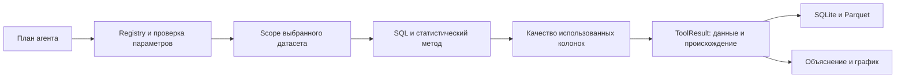

# Аналитика и бизнес-метрики

Аналитический слой выполняет вычисления по выбранному датасету и возвращает проверяемый результат: строки, факты, SQL, параметры, ограничения качества и происхождение чтения. Агент выбирает инструмент и объясняет результат; арифметика и статистические методы находятся в Python/DuckDB.

Для начала работы см. [руководство пользователя](../user/user-guide.md). Устройство исходных данных и каталога описано в [данных и каталоге](data-and-catalog.md), планирование и проверка ответа — в [агенте](agent.md).

## От вопроса до результата



Реестр [registry.py](../../src/djedai/analytics/registry.py) связывает имя функции, описание для модели, Pydantic-схему аргументов и исполнитель. Одни и те же определения используются для планирования и диспетчеризации. При добавлении инструмента нужно обновлять схемы, исполнение и приёмочный runtime-набор; одного описания в prompt недостаточно.

Продуктовый runtime передаёт настоящее соединение выбранного датасета, разрешённые таблицы и контекст подтверждённых метрик. Демонстрационные fallback-соединения некоторых низкоуровневых функций предназначены для изолированных вызовов и не участвуют в штатном HTTP-пути.

## Контракт ToolResult

| Поле | Смысл |
| --- | --- |
| `result_id`, `status` | Идентификатор вызова; `ok`, `empty` либо `error` |
| `data` | Колонки, строки, `row_count`, признак усечения `truncated` |
| `facts` | Текстовые факты с категорией и структурированными точными значениями |
| `sql`, `tool`, `params` | Как был получен результат |
| `chart_hint` | Рекомендация для визуализации; итоговый `ChartSpec` строится отдельно |
| `metric` | Версия подтверждённой бизнес-метрики, формула и популяция |
| `quality` | Потери/неоднозначности преобразования использованных колонок |
| `read` | Источник, ревизия каталога, время чтения и согласованность |
| `source_result_id` | Родитель конкретного зависимого вычисления |
| `error` | Код, понятное сообщение и возможная подсказка при `status="error"` |

`empty` означает отсутствие подходящих данных или результата анализа, а не успешное доказательство нулевого бизнес-показателя. Например, отсутствие обнаруженной сезонности и сумма0 имеют разный смысл. `error` всегда содержит `ToolError` и не должен интерпретироваться как нулевое значение.

Число строк и усечение нужно читать вместе. У инструментов с ограничением выдачи `row_count` обычно описывает возвращённые строки; оно не всегда равно размеру всей потенциальной выборки. `truncated=true` запрещает считать показанные строки полным исходником для зависимого агрегата. Семантика отдельных фактов описана ниже.

Контракт — [tool_result.py](../../src/djedai/contracts/tool_result.py). Сохранение результатов и Data API — в [API](api.md) и [архитектуре](architecture.md).

## Какие инструменты доступны

В реестре четырнадцать функций:

| Инструмент | Для чего использовать |
| --- | --- |
| `run_sql` | Явный SELECT/CTE/UNION и вычисления, не покрытые специальной функцией |
| `describe_dataset` | Обзор выбранных таблиц и их объёмов |
| `describe_column` | Профиль одного поля |
| `value_counts` | Частоты значений и top-N |
| `time_aggregate` | Агрегация по временным интервалам и группам |
| `find_duplicates` | Группы совпадающих строк по выбранным полям |
| `detect_anomalies` | IQR, z-score, MAD либо остатки STL |
| `seasonality` | STL-декомпозиция, сила тренда и сезонности |
| `segment_profile` | Размеры и описательные статистики сегментов |
| `compare_segments` | Статистическое сравнение двух сегментов |
| `compute_metric` | Расчёт подтверждённой бизнес-метрики |
| `correlation` | Попарные Pearson/Spearman/Kendall |
| `lagged_correlation` | Корреляция регулярных временных рядов по лагам, необязательный Granger |
| `forecast` | Прогноз ETS/ARIMA/seasonal naive с интервалом и необязательным holdout |

Общий набор функций находится в [tools.py](../../src/djedai/analytics/tools.py); подтверждённые метрики вынесены в [metrics.py](../../src/djedai/analytics/metrics.py). Ветка планирования дашборда показывает модели более узкий набор `run_sql`/`compute_metric`, чтобы виджеты имели компактные воспроизводимые рецепты.

## SQL и границы доступа

`run_sql` принимает один read-only запрос в диалекте DuckDB. Допускаются SELECT/UNION и CTE; операции изменения данных, несколько SQL-statements, чтение произвольных файлов и сетевые функции не разрешаются.

Проверки идут последовательно:

1. Pydantic валидирует контракт аргументов инструмента.
2. `sqlglot` разбирает запрос и проверяет форму.
3. Dataset scope проверяет настоящие таблицы и функции, включая подзапросы SQL-фильтра.
4. При наличии подтверждённых метрик применяется защита их grain.
5. DuckDB выполняет запрос на read-only соединении с отключённым external access.
6. Runtime ограничивает время и добавляет отчёт о качестве и происхождении.

Scope разрешает только публичные views каталога выбранного датасета, CTE и допустимые подзапросы. Raw-таблицы, служебные реестры, `information_schema`/`pg_catalog`, соседние attached-базы, file/network readers, PG passthrough и неизвестные macros недоступны. Quoting имён само по себе не обеспечивает эту границу, поэтому итоговые запросы специальных функций также проходят общий scope.

Пример исследовательского SQL для условного датасета с таблицей `orders`:

```sql
SELECT region, COUNT(*) AS attempts, SUM(amount) AS amount
FROM orders
WHERE created_at >= TIMESTAMP '2026-01-01'
  AND created_at < TIMESTAMP '2026-02-01'
GROUP BY region
ORDER BY amount DESC;
```

Имена и смысл `amount` в таком примере должны быть подтверждены реальным каталогом. Если «выручка» уже имеет утверждённое определение, нужен `compute_metric` по его ID.

Выдача `run_sql` ограничена `SQL_MAX_ROWS`, по умолчанию5000. Параметр `max_rows` только уменьшает этот предел. Ограничение накладывается через DuckDB relation `.limit()`, сохраняя исходные LIMIT/FETCH, ORDER BY и OFFSET. Достижение cap трактуется консервативно как возможное усечение. Лимит выдачи не ограничивает число строк, прочитанных для COUNT/SUM/JOIN.

По умолчанию время инструмента30с. `query_timer` учитывает остаток общего бюджета хода и отмену; DuckDB получает `interrupt`. Статистические CPU-методы проверяют бюджет в предусмотренных точках, но произвольный вызов стороннего fitter нельзя мгновенно остановить внутри Python-потока. Модельные стадии имеют свои сроки; общий ответ может завершиться раньше инструмента из-за исчерпания бюджета хода.

Реализация: [scope.py](../../src/djedai/analytics/scope.py), [queries.py](../../src/djedai/analytics/queries.py), [execution.py](../../src/djedai/execution.py).

## Обзор и частоты

`describe_dataset` показывает только таблицы разрешённого scope. Это аналитический обзор, отдельный от LLM-описаний каталога. `describe_column(table, column)` возвращает доступные сведения о конкретном поле и распределении. `value_counts(table, column, top_n, filter)` считает частоты по условию; допустимость фильтра проверяется в составе полного SQL.

Частоты нужны для понимания популяции и выбора категорий. Top-N не описывает все значения: маленькие категории остаются за пределами выдачи. Для вопроса о полном числе различных значений используйте соответствующий счётчик или явный SQL, а не длину top-N.

## Агрегация по времени

`time_aggregate(table, time_col, measure, agg, freq, group_by, filter, top_n)` строит временные buckets через `date_trunc`.

Поддержаны `minute`, `hour`, `day`, `week`, `month`, `quarter`, `year` и агрегаты `count`, `sum`, `avg`, `min`, `max`, `median`, `stddev`. Здесь `stddev` — `STDDEV_POP`. Для `count` без measure считается `COUNT(*)`, с measure — `COUNT(measure)`, то есть только непустые значения. Для остальных агрегатов мера обязательна. Колонка DATE не поддерживает minute/hour в этом инструменте.

Например:

```json
{
  "table": "orders",
  "time_col": "created_at",
  "measure": "amount",
  "agg": "sum",
  "freq": "month",
  "group_by": ["region"]
}
```

Строки с NULL-временем исключаются. Результат сортируется по времени и группам; ограничения top-N/cap применяются к строкам результата. При группировке на один временной bucket может приходиться несколько строк. Отсутствующие календарные buckets этим инструментом не достраиваются.

Сводные факты о числе buckets, диапазоне, min/max и среднем описывают возвращённые строки после ограничения. Если нужен полный календарный ряд, проверяйте `truncated`, не обрезайте его случайным top-N и явно определите смысл отсутствующих дат. В инструментах сезонности, лагов и прогноза правила заполнения другие.

## Дубли

`find_duplicates` группирует строки по `columns`; без списка используются все колонки выбранной typed view. Optional `include_all_columns` добавляет остальные поля как пример через `FIRST`, без гарантии порядка выбора. `limit` по умолчанию100 ограничивает число показанных групп, а не общий подсчёт дублей.

Пусть `T` — число строк популяции, `G` — полное число групп с количеством>1, `D` — сумма размеров этих групп. Тогда:

```text
строки, участвующие в дублях = D
лишние копии                = D - G
процент участвующих строк   = 100 × D / T
```

Для строк `A,A,A,B` получается одна группа дублей, три участвующие строки, две лишние копии и75%. Эти показатели имеют разные знаменатели и не взаимозаменяемы.

Сравнение typed колонок может объединить разные нераспознанные raw-значения, ставшие NULL. Профильные дубли исходных строк и результаты этого инструмента могут поэтому различаться. Инструмент только обнаруживает совпадения и не удаляет строки.

## Аномалии

`detect_anomalies` выбирает метод, порог, необязательные группы, фильтр и идентификатор строки. NULL меры исключены из точечных оценок; NULL-ключи групп сохраняются как самостоятельные группы.

| Метод | Граница по умолчанию |
| --- | --- |
| `iqr` | Ниже `Q1 − 1.5×IQR` либо выше `Q3 + 1.5×IQR`, где `IQR=Q3−Q1` |
| `zscore` | Вне `mean ± 3×STDDEV_POP` |
| `mad` | Вне `median ± 3.5×1.4826×median(abs(x−median))` |
| `stl-residual` | Абсолютный нормированный остаток STL больше3 |

Неравенства строгие: значение на границе не является выбросом по этому правилу. Порог можно задать явно положительным числом. «Аномалия» означает отклонение по выбранному статистическому правилу; инструмент не доказывает ошибку данных, нарушение бизнес-процесса или причинный эффект.

### Остатки STL

Для `stl-residual` нужны время и числовая мера. Инструмент сначала суммирует меру по временным buckets и группам. Default period:60 для minute,24 для hour,7 для day,52 для week,12 для month,4 для quarter. Year с периодом1 для STL отвергается. На группу требуется минимум `max(2×period,4)` наблюдений.

Ряд центрируется по медиане и масштабируется по максимальному отклонению. Это позволяет не менять результат только из-за большой постоянной базы или смены единиц измерения. Робастный STL выделяет тренд и сезонность, затем для residual рассчитывается медиана и масштаб `1.4826×MAD`; при нулевом MAD используется выборочное std. Нижняя граница масштаба подавляет погрешность floating point в нормированных единицах.

Неизвестные значения bucket дают `missing_data`, бесконечные — `invalid_data`. Полная календарная сетка для этого метода не достраивается: последовательность наблюдаемых buckets должна соответствовать выбранной частоте. Короткая либо неудачно обработанная отдельная группа может быть пропущена; отсутствие найденных выбросов не доказывает, что каждая группа прошла достаточный анализ. Данные для STL загружаются в память.

## Сезонность

`seasonality` строит `value`, `trend`, `seasonal`, `resid` для одного агрегированного ряда. Период задаётся явно либо берётся из той же карты частот, что и STL; он должен быть>=2. Перед расчётом нужно минимум два периода наблюдаемых buckets. Это технический минимум метода, а не подтверждение устойчивого календарного эффекта.

Сетка выравнивается по календарю; недельные buckets начинаются в понедельник. Для `sum`/`count` отсутствующие buckets заполняются нулями. Наблюдаемый NULL и пропуски других агрегатов дают `missing_data`, чтобы неизвестное среднее не стало выдуманным нулём. Постоянный ряд возвращает `empty` с объяснением.

Если `R`, `S`, `T` — остатки, сезонная часть и тренд, используются оценки:

```text
seasonal_strength = max(0, 1 - Var(R) / Var(S + R))
trend_strength    = max(0, 1 - Var(R) / Var(T + R))
```

Погрешность почти нулевой дисперсии учитывается в нормированных единицах. Сила>=0.6 обозначается сильной,>=0.3 умеренной, ниже — слабой. Это эвристические подписи. Средние сезонные фазы считаются по полным циклам; `peak_phase` — индекс относительно начала ряда, а для месяца/недели подпись учитывает реальную дату начала. Амплитуда — разница максимальной и минимальной средней сезонной фазы.

Расчёт использует весь загруженный ряд, а выдача ограничена `SQL_MAX_ROWS` с `truncated`. Большой диапазон на мелкой частоте может потребовать много памяти при создании календарной сетки; укрупняйте частоту и ограничивайте период фильтром. В этой функции нет общего предохранителя200000 buckets, применённого в лагах и forecast.

## Сегменты и их сравнение

### Профиль сегментов

`segment_profile(table, group_by, measures, filter, top_n)` строит совместные комбинации значений группировок. `group_by` содержит хотя бы одно поле; меры должны быть числовыми. Для сегмента считаются размер и AVG/MEDIAN/MIN/MAX/STDDEV_POP по мерам. Сегменты сортируются по размеру; default top-N100 ограничивает показ.

Важно отличать совместный сегмент `region × channel` от отдельных частот region и channel. Доля/размер сегмента относятся к популяции фильтра. Число сегментов, общее число строк и экстремумы средних считаются отдельным запросом по полной популяции до top-N. Таблица показывает только выбранный top-N; её нельзя объявлять полным перечнем сегментов.

### Два сегмента

`compare_segments` получает `segment_col`, два значения `a`/`b`, список measures, optional filter и `alpha` (по умолчанию0.05). Значения сегментов по API задаются строками и передаются параметрами SQL. Проверяется наличие двух различных сегментов после фильтра. Общий размер сегмента и число непустых наблюдений конкретной меры могут различаться.

Для числовой меры берутся все непустые наблюдения сегментов, применяется Welch t-test с `equal_var=False`. При менее двух значениях у одной стороны сравнение недоступно. Размер эффекта:

```text
pooled_sd = sqrt(((nA-1)×sA² + (nB-1)×sB²) / (nA+nB-2))
Cohen_d   = (meanA - meanB) / pooled_sd
```

При нулевой совместной дисперсии t-test и d обозначаются неопределёнными, а не нулевым эффектом. Значимость — `p_value < alpha`. Для категориальной меры используется chi-square contingency и Cramér V; NULL-категория сохраняется отдельно от текстового значения `"None"`.

Эти тесты не проверяют дизайн эксперимента, независимость наблюдений и все статистические предпосылки. Автоматической поправки на сравнение многих мер нет. Низкое p-value само по себе не доказывает практическую важность, устойчивость или причинность различия.

## Корреляция и лаги

### Попарные коэффициенты

`correlation(table, columns, method, filter, min_n)` принимает минимум две числовые колонки. Доступны Pearson, Spearman и Kendall. Для каждой пары используются совместно присутствующие значения; разные пары могут иметь разные `n`. Default `min_n=10` определяет предупреждение о малом числе наблюдений, а не гарантирует надёжность при n>=10.

Выдача содержит имена пары, `r`, `p_value`, `n`. Константный ряд и недостаток пар могут сделать коэффициент неопределённым. Сам факт успешного вызова не превращает такой результат в r=0. Перед расчётом колонки загружаются в память; число пар растёт квадратично с числом колонок. Корреляция описывает статистическую связь, а не доказанную причинность.

### Временной сдвиг

`lagged_correlation(table, time_col, a, b, freq, agg, max_lag, min_n, method, filter, include_granger)` сначала агрегирует две меры на регулярную календарную сетку. Pearson/Spearman доступны для лагов; default max_lag14, min_n10. Для sum/count отсутствующие buckets становятся нулями; для других агрегатов остаются неизвестными и исключаются попарно.

Принята конвенция:

```text
lag = k  ⇒  сравниваются a(t) и b(t+k)
k > 0    ⇒  a опережает b
```

Проверяются все сдвиги от `−max_lag` до `+max_lag`. Среди допустимых n выбирается максимальный `|r|`; при точном равенстве остаётся первый в порядке перебора. Поиск лучшего из многих сдвигов увеличивает риск случайной находки — инструмент добавляет это ограничение. Отложенная проверка и корректировка множественных p-values автоматически не выполняются.

Перед созданием сетки оценивается её размер: свыше200000 buckets запрос отклоняется с предложением укрупнить частоту, сузить даты или проверить ошибочную дату. Это защищает от сочетания, например, минутной частоты и диапазона в десятки лет.

При `include_granger=true` дополнительно проверяется направленная предсказуемость a→b тестом Granger. Нужны минимум30 наблюдений и полная регулярная сетка; ряд с пропусками не сжимается через dropna, чтобы календарный лаг не изменил смысл. Максимальный порядок ограничен10 и указанным max_lag. Выбирается p-value среди рассчитанных порядков с предупреждением о статистических пределах. Нестационарность, многократный поиск и сторонние факторы не устраняются; это не доказательство причинности.

## Прогнозирование

`forecast` агрегирует историю выбранной меры и строит будущие точки `yhat`, `yhat_lower`, `yhat_upper`. В зарегистрированном контракте горизонт `horizon` от1 до180 периодов. Доступны `ets`, `arima`, `naive`; default ETS, частота day, уровень `alpha=0.05`, то есть заявленный модельный интервал95%.

Пример для условной таблицы:

```json
{
  "table": "orders",
  "time_col": "created_at",
  "measure": "amount",
  "agg": "sum",
  "freq": "day",
  "period": 7,
  "horizon": 14,
  "method": "naive",
  "holdout": 7
}
```

### Подготовка ряда

Время должно иметь тип DATE/TIMESTAMP, мера — числовой тип. Для count мера необязательна. История сортируется и выравнивается по календарю с понедельником для week, началом месяца/квартала/года для соответствующих частот. До reindex действует ограничение200000 buckets. Для sum/count пропуски и NULL агрегированной серии заполняются нулями; для остальных агрегатов неизвестные buckets дают `missing_data`. Такой ноль — правило подготовки ряда и требует содержательной проверки: неизвестная сумма не всегда означает отсутствие событий.

Default сезонный period зависит от частоты:60/24/7/52/12/4/1. Для несезонного naive можно явно задать period1. Минимум истории — `max(2×period,5)` точек; дополнительные условия конкретного fitter описаны ниже. Прогноз начинается с одного следующего календарного bucket после конца истории.

### Методы и интервалы

| Метод | Точечная модель | Интервал |
| --- | --- | --- |
| ETS | Holt-Winters с аддитивным трендом; аддитивная сезонность при period>=2 и достаточной истории | Нормальный квантиль × оценка std остатков × аналитический множитель ошибки ETS |
| ARIMA | ARIMA(1,1,1); при >=4 сезонах пробуется SARIMAX с seasonal_order(1,1,1,period) | `get_forecast().conf_int(alpha)` выбранной модели |
| Naive | Повтор последнего значения либо последнего полного сезонного шаблона | Ошибка сезонных разностей с ростом по числу пройденных сезонов |

Для ETS применяется дисперсия `σ²×(1+Σc_j²)`, где коэффициенты зависят от уровня, тренда и сезонности обученной модели. Для naive с периодом p полуширина на шаге h равна:

```text
z(1-alpha/2) × std(y[t] - y[t-p]) × sqrt(1 + floor((h-1)/p))
```

При p=1 множитель превращается в sqrt(h). Если сезонный SARIMAX не сошёлся или упал, используется несезонный ARIMA. Это предусмотренный fallback реализации, а не обещание, что любой ряд успешно моделируется. Ошибка основного fitting возвращает `forecast_failed`.

Интервал отражает допущения выбранной модели и устойчивость прежних закономерностей. Он не является гарантией, эмпирически подтверждённым покрытием или причинным сценарием. Прогноз остаётся числовым и может дать отрицательные/дробные значения даже для счётчика: автоматического округления, ограничения нулём и бизнес-калибровки нет.

### Holdout

При заданном holdout последние N точек откладываются, fitter обучается только на предыдущей части и предсказывает эти N точек. Считаются:

```text
MAE  = mean(abs(actual - prediction))
RMSE = sqrt(mean((actual - prediction)²))
MAPE = 100 × mean(abs((actual - prediction) / actual))
```

MAPE отсутствует, если среди фактических значений есть0. Если holdout не оставляет достаточно обучающей истории либо fitting проверки не выполнен, в facts добавляется предупреждение; основной прогноз по полной истории ещё может быть построен. Поэтому успешный forecast не всегда означает успешный backtest. Основной будущий прогноз после holdout обучается заново на всей доступной истории.

Один holdout не оценивает стабильность на всех периодах и не проверяет покрытие интервала. Свободного инструмента `what_if` и автоматического причинного сценарного моделирования в реестре нет.

## Подтверждённые бизнес-метрики

Метрика задаёт смысл вычисления: что является одной строкой наблюдения, какие строки входят в популяцию, какая мера используется, единица, валюта и календарь. Имена колонок и LLM-описания могут предложить определение, но в расчёт `compute_metric` идёт подтверждённая пользователем версия.

Определения хранятся отдельно от пересобираемого каталога. Подтверждение через API либо вариант уточнения создаёт новую неизменяемую версию; предыдущая становится retired. Старые результаты сохраняют ссылку на свою версию. Отсутствие определения возвращается как `metric_undefined`; исследовательский SQL без подтверждённых метрик по-прежнему доступен.

### Структура определения

- `grain` — таблица и её одиночный уникальный ключ;
- `kind` — sum, count, count_distinct либо ratio;
- `measure`, `filters` — мера и популяция;
- `unit`, `currency` либо `currency_column` — единица и валюта;
- `time_column` — календарь;
- `additivity` — допустимость сложения либо необходимость пересчёта;
- у ratio — ссылки на подтверждённые numerator/denominator.

Формула структурирована, произвольный SQL в определение не подставляется. Перед использованием она заново сверяется с каталогом; исчезнувшая колонка даёт `metric_definition_stale`.

`compute_metric(metric_id, group_by, period_start, period_end, time_grain, currency, filters)` строит SQL на grain определения. Период полуоткрытый `[start,end)`. Смещение часового пояса в границе отклоняется, сравнение идёт в системе времени исходных значений. Составной grain и многоступенчатые цепочки измерений не поддержаны.

Измерения присоединяются только одной связью каталога N:1 с confidence high. Затем связь проверяется на фактической популяции: несколько строк на grain дают `metric_grain_violation`, пустые ключи/строки без пары — `metric_rows_lost`. `DISTINCT` не исправляет ошибочный grain. Деньги разных валют нельзя молча сложить: нужен выбор валюты либо разбивка; курсов пересчёта нет.

Отношение считается после агрегации каждой составляющей на собственном grain. Это не среднее готовых долей. Если у составляющей нет календаря, период не игнорируется молча: возвращается `metric_period_unsupported`.

### Защита произвольного SQL

Если `run_sql` агрегирует меру подтверждённой метрики, статический guard прослеживает её через CTE, подзапросы, UNION, `*` и алиасы. JOIN, который может размножить grain или потерять строки без доказанной полноты, отклоняется. MIN/MAX исключены из этой проверки агрегатов; `COUNT(DISTINCT)` и DISTINCT внутри CTE её не обходят. Неразобранный guard возвращает `metric_guard_failed`.

Guard консервативен и относится к мерам подтверждённых определений. Он не доказывает бизнес-корректность любого пользовательского SQL. Реализация и причины — [metrics.py](../../src/djedai/analytics/metrics.py), [контракт metrics](../../src/djedai/contracts/metrics.py), [решение о семантике](../decisions/166-metric-semantics.md).

## Качество колонок расчёта

Raw→typed может потерять значения, и успешный SUM не означает полной суммы. Runtime чата вызывает `assess` после выполнения инструмента. `QualityReport` связывает использованные колонки с преобразованием, назначением в SQL, знаменателем популяции, исходными пропусками и потерями.

Lineage прослеживает колонки через CTE, подзапросы и производные выражения. Для меры/вывода/группировки популяция определяется на строках соответствующего scope после JOIN/WHERE; фильтр дополнительно проверяет строки, отброшенные из-за нераспознанного значения. Подсчёт качества выполняется на том же соединении и включён во время чтения результата.

При невозможности точного подсчёта — например, JOIN key, коррелированный подзапрос или неподдержанный путь lineage — используются данные профиля таблицы с `scope="table"` и обязательным объяснением `boundary`. Отчёт не подменяет границу знания выдуманным числом. Для одной колонки в нескольких популяциях выбирается популяция с наибольшими потерями.

| Ограничение | Поведение |
| --- | --- |
| Потеря разбора меры/фильтра/группы/вывода | Warning при любой ненулевой потере |
| Колонка осталась текстом из-за порога | Warning при использовании в вычислении |
| Неоднозначная дата в вычислении/фильтре/группе | Blocking с вариантами уточнения |
| Смешанные валюты в агрегате | Blocking |
| Процент без `%`, сумма процентов, неоднозначный разделитель | Warning |
| Только исходный пропуск | Отдельный счётчик, сам по себе не ошибка разбора |

Ответ пользователя на вариант снимает соответствующую блокировку для текущего вопроса. Формат в каталоге этим не меняется; новый вопрос может потребовать нового решения. Для нескольких последовательных уточнений backend сохраняет исходный вопрос и накопленные выборы.

Модель получает факты `data_quality`, а узел `cite_metrics` обычной ветки независимо от неё добавляет «Ограничения данных» и источник чтения. Живые типизированные PostgreSQL-значения не проходят CSV-разбор и не получают выдуманные потери парсинга. Источники и правила — [lineage.py](../../src/djedai/analytics/lineage.py), [quality.py](../../src/djedai/analytics/quality.py), [решение о потерях](../decisions/168-typing-losses.md).

## Зависимые вычисления и дашборды

Обычный план чата не принимает `source_result_id` в аргументах registry. Ветка дашборда и автономный refresh передают родителя отдельно, регистрируют его строки как временный `source_result` и расширяют scope только на это представление. После шага оно удаляется.

Если родитель усечён либо `row_count` больше числа доступных rows, зависимый шаг даёт `dependency_truncated`: неполные данные не агрегируются под видом полного источника. Рецепт хранит стабильный `source_step_id`, а конкретный выполненный результат — `source_result_id`. Поэтому refresh способен заново получить родителя и не зависит от временного UUID первого расчёта. Подробности — [ветка дашборда](agent.md#отдельная-ветка-дашборда) и [решение о refresh](../decisions/97-dashboard-api-refresh.md).

## Аналитические инструменты #66

`time_aggregate`, `find_duplicates` и `detect_anomalies` принимают серверный
`allowed_tables` так же, как базовые инструменты. Проверка таблицы выполняется до
чтения метаданных; каждый итоговый запрос, включая запросы статистики и фильтры с
подзапросами, проходит общий SQL scope. Фильтр не может читать raw, системную или
чужую таблицу. Передача контекста из реестра сохраняется.

Инструменты используют общий `query_timer` из #158; deadline и отмена проверяются
также до и после CPU-этапа STL. Это кооперативная отмена: сторонняя функция STL
завершает текущий вызов, но после отмены следующий этап/публикация не продолжается.
Ограничение числа фактически работающих CPU-задач относится к #172.

STL-анализ аномалий центрирует ряд по медиане и нормирует на наблюдаемый размах
отклонений. Порог численного шума применяется к нормированным остаткам, а не к
абсолютному уровню или единицам метрики. Постоянный ряд остаётся пустым результатом;
остатки возвращаются в исходных единицах. Для воспроизведения замечаний проверяются
три скачка на 84 днях, умножение на `1e-12`, смещение на `1e12` и смена знака.

Если агрегат существующего бакета равен NULL/NaN, STL возвращает `missing_data`,
а при бесконечном значении — `invalid_data`. Проверяются все группы до расчёта:
неполный ряд не даёт утверждения «аномалий не обнаружено» или частичного успеха
по остальным группам. Неизвестные значения не заполняются нулями и не удаляются.

Все зарегистрированные инструменты проходят общий
[защищённый runtime gate #171](#защищённый-runtime-gate--171), включая сохранённый
отказ на недопустимый подзапрос.

Новые результаты используют полный UUID. Прямые численные зависимости перенесены
в runtime и закреплены на уже выбранных lock-файлом версиях; обновления версий
библиотек этим изменением не производится.

### Сезонность и сегменты — #67

Все шесть новых функций проходят один защищённый SQL-путь. Для трёх функций #67
добавлены те же unit-проверки фильтров и полный auth/CSV/chat/storage-прогон.

- Недельные метки совпадают с `DATE_TRUNC('week')`: индекс использует `W-MON`.
  Часовые и минутные бакеты сохраняют время в ISO-метке. Пиковая календарная подпись
  вычисляется по дате соответствующей фазы, а не по её относительному номеру.
- Существующий NULL-агрегат приводит к `missing_data`, а не к успешному STL с NaN.
  Отсутствующие sum/count-бакеты заполняются нулями с фактом о пропусках; для
  avg/median/min/max/stddev неизвестные значения не выдумываются. Не конечные числа
  отклоняются до публикации. Анализ и факты используют полный ряд, выдача ограничена
  `sql_max_rows` с честным `truncated`.
- STL центрирует и нормирует ряд до декомпозиции. Сила тренда и сезонности не
  вычисляется делением дисперсий численного шума: вариация на уровне погрешности
  нормированного ряда даёт силу 0. Линейный ряд не получает ложную сезонность,
  чистая сезонная волна с постоянным уровнем — ложный тренд. Компоненты и амплитуда
  возвращаются в исходных единицах; смена единиц не меняет вывод.
- Значения сегментов сравниваются SQL с типом исходной колонки. Все размеры групп
  и статистики используют один фильтр. Профиль отдельно считает полные итоги и
  экстремумы средних; top_n ограничивает только показанные группы. Имена колонок
  и производных алиасов экранируются, включая пробелы и кавычки.
  Служебные колонки профиля получают уникальные имена: если ключ группировки уже
  называется `segment_size`, размер группы будет `segment_size_1` (или следующим
  свободным суффиксом). То же правило защищает статистики вроде `v_mean`, включая
  коллизии регистра. Итоги и `chart_hint` используют фактические имена результата.
- При нулевой совместной дисперсии численного сравнения эффект и p-value равны
  `null`, `effect_size_name='undefined_effect'`, факт сообщает неприменимость теста.
  Такой случай не называется отсутствием эффекта или доказанной незначимостью.
- Категориальное сравнение сохраняет различие SQL NULL и строки `None` и использует
  все частоты. При ожидаемой частоте меньше 5 возвращается `insufficient_data`,
  Fisher exact не подставляется. Число выдаваемых сравнений также ограничено общим
  лимитом результатов.

Правила индекса сверены с [документацией pandas](https://pandas.pydata.org/docs/user_guide/timeseries.html).
Применимость Welch и таблицы сопряжённости описывают
[SciPy ttest_ind](https://docs.scipy.org/doc/scipy/reference/generated/scipy.stats.ttest_ind.html)
и [chi2_contingency](https://docs.scipy.org/doc/scipy/reference/generated/scipy.stats.chi2_contingency.html).

### Бизнес-метрики — #166

`compute_metric(metric_id, group_by, period_start, period_end, time_grain, currency,
filters)` считает подтверждённую метрику по её определению (`MetricDefinition`).
Для подтверждённой метрики агент вызывает этот инструмент, а не `run_sql`.

- Агрегат строится по строкам grain-таблицы с популяцией из определения.
- Период полуоткрытый, `[period_start, period_end)`, по календарю метрики.
- Измерения из `group_by` и `filters` присоединяются только по связи каталога N:1 с
  уверенностью `high`. До расчёта связь проверяется на популяции: размножение строк —
  `metric_grain_violation`, пустые ключи и строки без пары — `metric_rows_lost`.
- Смешанные валюты дают `metric_mixed_currency`: нужно выбрать `currency` или
  разбить по колонке валюты. Валюты проверяются на всей популяции расчёта, включая
  фильтры по измерениям.
- Отношение делится после агрегации числителя и знаменателя.
- Результат несёт `metric` (`MetricProvenance`) и факт `metric_definition` с версией
  и ограничениями.

`run_sql` получает тот же `MetricContext` и отклоняет агрегат меры подтверждённой
метрики после JOIN с размножением или недоказанной полнотой. Мера прослеживается через
CTE, подзапросы, UNION, `*` и списки колонок алиаса: JOIN уровнем ниже внешнего SUM
тоже проверяется. `COUNT(DISTINCT)` и `DISTINCT` в CTE такой запрос не пропускают.
Без подтверждённых метрик поведение `run_sql` не меняется.

Решения и границы описаны в [B2-9 / #166](../decisions/166-metric-semantics.md).

### Качество колонок расчёта — #168

Каждый результат инструмента в чате получает `quality` (`QualityReport`). В нём —
колонки, которые использовал SQL результата, и ограничения их преобразования:
нераспознанные значения в популяции расчёта, колонка ниже порога, неоднозначные даты,
смешанные валюты, проценты и разделитель. Числа считаются на строках расчёта после
JOIN и WHERE. Если это невозможно, берётся профиль таблицы с явной границей знания.
Факты `data_quality` попадают в compose и verify, а блок «Ограничения данных» —
в ответ.

Решения и правила описаны в [B2-10 / #168](../decisions/168-typing-losses.md).

### Защищённый runtime gate — #171

`tests/integration/test_analytics_tools_runtime.py` сверяет явные сценарии с
`TOOLS_REGISTRY`. Их 14: `run_sql`, `describe_dataset`,
`describe_column`, `value_counts`, `time_aggregate`, `find_duplicates`,
`detect_anomalies`, `seasonality`, `segment_profile`, `compare_segments`,
`compute_metric`, `correlation`, `lagged_correlation` и `forecast`.

Положительные сценарии проходят настоящие регистрацию и вход, загрузку CSV,
выбор датасета в чате, граф агента, диспетчеризацию, SQLite и Parquet; выполняемые
запросы проходят SQL scope. Управляемая модель задаёт план; аналитические функции
и сохранение не заменены заглушками. Наблюдатели передают вызовы настоящим функциям
и фиксируют scope, отказ валидатора и исходный результат перед сериализацией.
После выполнения создаётся новое приложение и новое соединение к
той же БД: результат читается по `result_id`, его строки, `status`, `facts`,
`metric` и `error` сверяются с ожидаемым результатом. Проверяется также
сохранение ссылки на результат в истории чата. Единицы бизнес-метрики проверяются
в её `MetricProvenance`, где они определены контрактом.

Матрица доступа включает допустимую таблицу и фильтр, неизвестную таблицу,
служебную/raw таблицу, внутреннюю таблицу, датасет другого владельца и другой
датасет того же владельца. Недопустимая таблица проверяется также во вложенном
`SELECT` фильтра. Отказы должны сохраниться как ошибки без чужих данных и без
Parquet с успешным результатом. Допустимость проверяется в итоговом SQL, а не
только по полю `table`.

Сценарий учитывает форму каждого контракта: `describe_dataset` не получает
выдуманное поле `table` и показывает только выбранный датасет. У него и у
`describe_column` нет параметра SQL-фильтра. `compute_metric`
использует подтверждённое определение и структурированные `filters`; SQL-строка
`filter` ему не добавляется. Для SQL-инструментов проверяется вложенный запрос,
а для метрики — доступ к её определению и участвующим таблицам.

Набор проверяет собственную чувствительность управляемыми мутациями: лишний
инструмент в реестре без сценария, несовместимая сигнатура без `allowed_tables`,
потеря `facts`/`metric`/`error` при сериализации, удаление `allowed_tables` и
отключение SQL scope. Мутации
ограничены тестом и должны обнаруживаться проверками контракта. Успех не
подменяется пустым `ok`; защитный контекст не удаляется ради совместимости.

Чтобы добавить инструмент, нужно добавить явный сценарий с подходящими
параметрами, независимым ожидаемым результатом и проверками доступа по его
контракту. `skip`, автоматическое заполнение сценария из JSON Schema или
исключение из сравнения с реестром не заменяют покрытие. После изменения запускаем:

```sh
uv run --locked pytest --strict-markers tests/integration/test_analytics_tools_runtime.py
```

Внешняя модель, ключ API и внешние БД этому набору не нужны. В CI он выполняется
один раз отдельным шагом `Test registered tools through protected runtime and
storage` внутри обязательного Python job. Базовый unit-прогон исключает
`integration`, поэтому этот шаг не дублирует полный Python suite. Ошибка набора
блокирует итоговую проверку `required`.

## Проверки и пределы гарантии

Приёмочный [runtime gate](../../tests/integration/test_analytics_tools_runtime.py) сопоставляет явные сценарии со всеми зарегистрированными функциями. Он проходит настоящий путь auth→CSV→chat→graph→dispatcher→SQL scope→SQLite/Parquet→новое приложение→чтение результата. Модель управляемая: планы предсказуемы, а вычисления и хранение настоящие. Новый инструмент без независимого сценария должен ломать gate.

Это дополняется [unit analytics](../../tests/unit/analytics), [проверками метрик](../../tests/integration/test_metric_api.py), [quality API](../../tests/integration/test_quality_api.py) и другими уровнями из [quality.md](quality.md). Успех таких проверок подтверждает их сценарии; он не означает, что реальная модель уже правильно решила все свободные вопросы или весь golden-набор.

Практические ограничения аналитики: полные выборки для ряда статистических функций загружаются в память; лимит выдачи не является лимитом вычислительных затрат; округление/валюта/популяция требуют правильной интерпретации; статистическая связь и прогноз не доказывают причинность. Детерминированная проверка чисел перед публикацией ([решение #167](../decisions/167-numeric-verification.md)) сохраняет итог в отчёте, а ответ с неподтверждённым числом может заменить отказом; смысл вывода она не доказывает.
