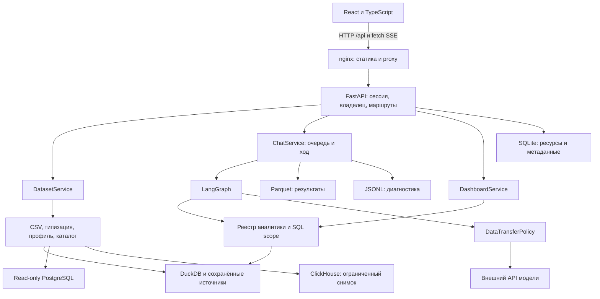
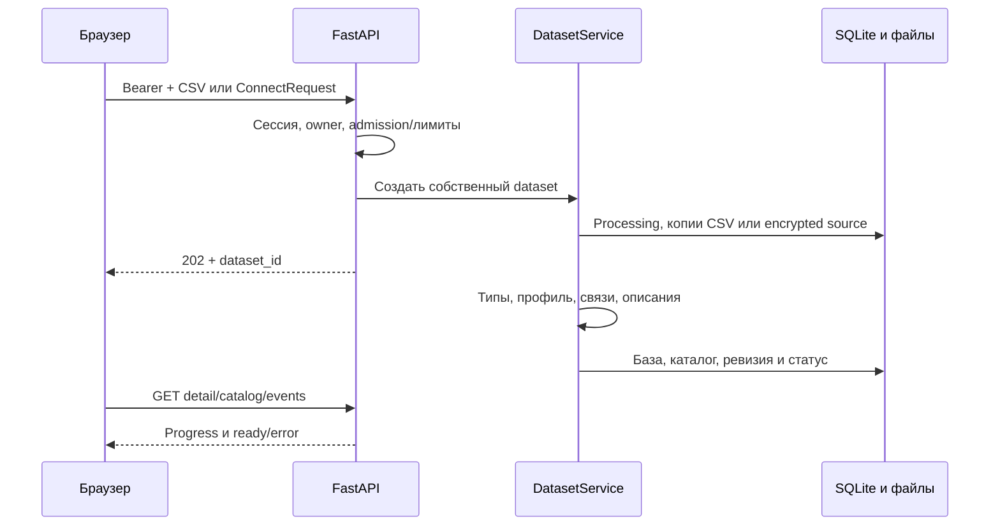

# Архитектура

DjedAI — монорепозиторий Python + React. Данные, аналитика, агент, backend и контракты меняются совместно. Основная поставка — один backend и frontend/nginx; API модели и подключённые БД являются отдельными сетевыми системами.

## Компоненты



| Часть | Ответственность | Код |
| --- | --- | --- |
| Frontend | Навигация, сессия, server cache, формы, потоки, блоки, ECharts | `frontend/src/` |
| Backend | HTTP/SSE, ownership, жизненный цикл, persistence, admission/квоты | `src/djedai/backend/` |
| Data | CSV/БД, typed views, профиль, каталог, source reader и ревизии | `src/djedai/data/` |
| Analytics | Валидируемые инструменты, SQL scope, статистика, метрики, качество | `src/djedai/analytics/` |
| Agent | Модельный клиент, граф, память, prompts, визуализация/dashboard, политика контекста | `src/djedai/agent/` |
| Contracts | Общие модели каталога, результата, сообщений, графиков, рецептов и API | `src/djedai/contracts/` |

Backend создаёт доверенный runtime-контекст. Модель не получает прямое подключение к SQLite/DuckDB и не определяет `owner_id`.

## Контракты

Python-компоненты импортируют Pydantic-модели напрямую. Public `MessageBlock` и внутренний агентский `Block` имеют разное назначение: backend преобразует результат графа в стабильный формат браузера.

```text
Pydantic + FastAPI routes
 → scripts/export_frontend_contracts.py
 → frontend/schema/openapi.yaml + contracts.json
 → npm run gen:types
 → frontend/src/api/generated.ts
```

Несовместимое изменение требует обновления схем, примеров и потребителей; сохранённым объектам может понадобиться миграция. Поля API не копируются вручную в независимую frontend-модель. См. [API](api.md), [разработку](development.md).

## Загрузка и подключение источника



CSV сохраняется собственными копиями, а typed views не перезаписывают raw. PostgreSQL читается через доверенный read-only source reader. Выбранные ClickHouse-таблицы материализуются локально в пределах объёма и timeout.

LLM-описания включаются конфигурацией. Сбой модели может оставить предупреждение при доступном статистическом каталоге. Принятые обработки восстанавливаются из сохранённого состояния; закрытие браузера после accepted-ответа не меняет владельца dataset.

Каталог — профиль определённой ревизии. Живой PostgreSQL может измениться после профилирования; freshness и перепрофилировка отделены от чтения сохранённого каталога. [Подробнее](data-and-catalog.md).

## Обработка вопроса

1. API проверяет Bearer, владельца чата и его датасет. Admission ограничивает workers и очередь.
2. Runtime получает каталог, подтверждённые метрики, память чата и аналитический scope.
3. Создаётся общий `ExecutionBudget`; стадии, сеть, повторы, инструменты и публикация используют остаток времени.
4. `understand` разрешает вопрос относительно данных/истории. Неоднозначность ведёт к уточнению.
5. Обычная ветка планирует инструменты, исполняет их, выбирает визуализацию, формирует и проверяет текст. Dashboard имеет отдельный маршрут.
6. Вызываются зарегистрированные инструменты. Серверный scope ограничивает таблицы, функции и зависимости; read-only SQL не разрешает произвольное чтение файлов/сети.
7. Результаты и provenance сохраняются; ассистент публикуется после предусмотренных проверок. SSE передаёт статусы, события инструментов, блоки и терминальный исход.

Модельные вызовы проходят единую политику данных непосредственно перед сетью. Диагностика связывает run/stage/model call и фактические попытки. [Агент](agent.md), [аналитика](analytics.md).

## Dashboard и refresh

`intent=dashboard` направляется в `plan_dashboard → execute_dashboard → save_dashboard`. Это отдельная ветка, а не пять шагов обычного плана. Её планировщик использует `run_sql` и `compute_metric` для воспроизводимых определений.

Виджет хранит независимый tool call или рецепт с зависимостями; временный result UUID не является единственным источником пересчёта. Чтение dashboard возвращает snapshot. Явный refresh повторяет вычисления без активного чата/LLM и создаёт новые `result_id`.

Ошибка виджета не уничтожает успешные соседние результаты. Старое число не выдаётся за свежий неуспешный расчёт. SourceReader фиксирует согласованность чтений, включая общий PostgreSQL snapshot refresh. [API/refresh](../decisions/97-dashboard-api-refresh.md), [ветка агента](../decisions/78-dashboard-branch.md).

График обычного ответа также можно сохранить в дашборд. Frontend отправляет его спецификацию и идентификатор результата; backend проверяет владельца и восстанавливает воспроизводимый рецепт по сохранённой цепочке вычислений. [Путь сохранения из чата](../decisions/88-how-calculated-save-to-dashboard.md).

## Постоянные данные

| Слой | Назначение | Compose |
| --- | --- | --- |
| SQLite | Users/sessions, datasets/catalog, chats/messages/turns, results audit, dashboards, метрики, настройки модели | `/app/var/app.db` |
| Dataset-файлы | CSV, DuckDB, views, профили; материализация ClickHouse | `/app/var/data/datasets` |
| Parquet | Табличные данные ToolResult | `/app/var/data/results` |
| JSONL | Стадии/попытки/исходы, usage и доступная оценка стоимости | `/app/var/diagnostics` |
| Внешний PostgreSQL | Живые таблицы источника | Вне app-data |

SQLite-запись не включает все строки Parquet, а backup app-data не копирует внешнюю PostgreSQL. Для encrypted source/model credentials нужен прежний `SOURCE_ENCRYPTION_KEY`. [Эксплуатация](../administrator/operations.md) описывает согласованную копию и восстановление.

FK задают связи, но ownership вложенных references, файлов и рецептов проверяется дополнительно. SQLite и файлы не образуют общей транзакции. Result ID защищён от конкурентного перезаписывания; orphan cleanup и восстановление остаются отдельными эксплуатационными задачами.

## Сессия и доступ

Пароль хранится через Argon2id. При login выдаётся opaque token, в SQLite сохраняется SHA-256 verifier, expiry и отзыв. Срок сессии — 24 часа без автоматического refresh.

UI держит токен в памяти/sessionStorage и передаёт Bearer для JSON, multipart, GET/POST SSE. После reload сначала `/auth/me`, затем личные queries. Logout/401/403/смена аккаунта закрывают запросы и очищают workspace/cache.

Чужой и неизвестный ресурс скрываются одинаковым 404. Guard повторно проверяет уже открытый SSE, включая idle-поток. `CP1_LOCAL_MODE` не обходит Bearer. [API](api.md), [frontend](frontend.md).

## Нагрузка и отмена

Установка имеет общие и per-owner лимиты workers, очередей и обработки источников. Один чат не запускает два произвольных конкурирующих хода. Переполнение/timeout admission возвращает явную ошибку.

Stop/disconnect/revoke/deadline закрывают SSE и текущий HTTP модели; DuckDB получает interrupt. Произвольный синхронный Python/C-код нельзя безопасно убить внутри потока. Permit удерживается до фактического выхода worker: закрывшийся HTTP не означает уже освобождённый CPU.

Это модель одной backend-реплики с локальными файлами и SQLite. Несколько backend/хостов требуют общей стратегии storage, очередей, rate limits и диагностики. Defaults и область каждого ограничения — [конфигурация](../configuration.md), [решение о нагрузке](../decisions/172-concurrency-queues-upload.md).

## Основные принятые решения

| Решение | Какую задачу решает | Следствие и граница |
| --- | --- | --- |
| Один монорепозиторий и общие Pydantic-контракты | Согласованно менять backend, агент и UI | Схемы и TypeScript генерируются; несовместимое изменение требует обновления всех потребителей. |
| SQLite и локальные файлы в одном постоянном томе | Запускать приложение без отдельного сервера метаданных | Поставка рассчитана на одну backend-реплику; согласованная резервная копия включает весь том. |
| Сохранённый raw и отдельное типизированное представление | Различать исходные данные, пропуски и потери преобразования | Профиль и результаты должны показывать качество; типизация не переписывает исходный CSV. |
| DuckDB для локальной аналитики, read-only reader для PostgreSQL | Исполнять SQL и инструменты на подходящем источнике | ClickHouse импортируется снимком; свежесть разных источников имеет разный смысл. |
| Parquet и provenance для результата инструмента | Повторно открывать ответ и проверять происхождение чисел | Сохранённый результат не становится свежим автоматически; refresh — отдельное вычисление. |
| Типизированные стадии агента и реестр инструментов | Связать вопрос с вычислением и контролируемой публикацией | Валидная схема не доказывает смысловую правильность; ограничения проверки описаны в [главе агента](agent.md). |
| Декларативный ChartSpec вместо произвольного кода графика | Согласовать визуализацию с данными и общим renderer | Браузер проверяет поля и конфигурацию; новый тип графика требует общего контракта и реализации. |
| Сохранённый рецепт dashboard | Пересчитывать виджеты независимо от открытого чата | GET читает snapshot, явный refresh исполняет инструменты без нового обращения к модели. |
| Серверные ownership/scope и единая data policy | Ограничить чтение ресурсов и контекст внешней модели | Prompt не задаёт права. Restricted policy всё ещё разрешает текущие значения результата. |
| Общие настройки модели, серверный ключ по умолчанию | Управлять провайдером одной установки | Это не персональные настройки аккаунта; смена модели влияет на последующие ходы других пользователей. |
| Отдельные уровни приёмки | Проверять расчёты, контракт, браузер и модель по их назначению | Прохождение CI или mock-сценария не заменяет независимую проверку чисел на рабочем источнике. |

Подробности и история находятся в [реестре решений](../decisions/47-contracts-and-runtime.md), [данных](data-and-catalog.md), [аналитике](analytics.md), [frontend](frontend.md) и [качестве](quality.md).

## Архитектурные правила

- Owner и scope определяет сервер, а не JSON пользователя или prompt.
- Raw сохраняется; исходные пропуски и ошибки преобразования различаются.
- Число происходит из расчёта, бизнес-смысл — из вопроса/подтверждённой метрики.
- Модель получает разрешённый политикой контекст.
- API имеет общие contracts; frontend не пересчитывает серверные бизнес-агрегаты.
- План, реализация и принятый сценарий имеют разный статус.

Далее: [backend](backend.md), [данные](data-and-catalog.md), [аналитика](analytics.md), [агент](agent.md), [frontend](frontend.md), [API](api.md), [качество](quality.md).
