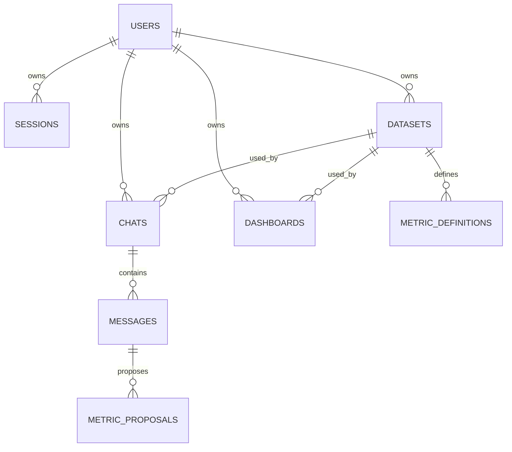

# Backend и постоянное хранение

Backend связывает браузер, источники, аналитические инструменты и модель с постоянными пользовательскими ресурсами. Он определяет владельца, принимает и ограничивает работу, сохраняет её исход, отдаёт HTTP/SSE и повторно открывает данные после перезапуска. Численные методы описаны в [аналитике](analytics.md), граф модели — в [агенте](agent.md), форматы запросов — в [API](api.md).

## Слои и карта кода

| Слой | Основные файлы | Ответственность |
| --- | --- | --- |
| Сборка приложения | [app.py](../../src/djedai/backend/app.py), [config.py](../../src/djedai/backend/config.py) | FastAPI, app state/lifespan, middleware, ошибки, OpenAPI, настройки |
| HTTP | [api/router.py](../../src/djedai/backend/api/router.py), [api/routes/](../../src/djedai/backend/api/routes) | Входные схемы, auth dependencies, статусы, ресурсные операции и потоки |
| Сессия и доступ | [auth/](../../src/djedai/backend/auth) | Пароль/токен, попытки входа, текущий владелец, проверка уже открытого потока |
| Датасеты | [dataset_service.py](../../src/djedai/backend/dataset_service.py) | Приём CSV/подключений, файлы, обработка, каталог, fresh/refresh, очередь и recovery |
| Чат | [chat_service.py](../../src/djedai/backend/chat_service.py), [chat_turns.py](../../src/djedai/backend/chat_turns.py), [admission.py](../../src/djedai/backend/admission.py) | Runtime графа, бюджет, admission, сохранение результата/блоков, исход вопроса и отмена |
| Дашборды | [dashboard_service.py](../../src/djedai/backend/dashboard_service.py) | Проверка рецепта, сохранение, snapshot, изменение и автономный refresh |
| Метрики | [metric_service.py](../../src/djedai/backend/metric_service.py) | Предложения, подтверждение, версия и вывод определения из употребления |
| Модель установки | [model_settings.py](../../src/djedai/backend/model_settings.py) | Общие overrides, шифрование ключа, разрешённые модели, короткая проверка |
| База и результаты | [db/](../../src/djedai/backend/db), [migrations/](../../src/djedai/backend/migrations) | SQLAlchemy, транзакции и ограничения, Parquet, преобразование сохранённого объекта в контракт |
| Наблюдение | [sse.py](../../src/djedai/backend/sse.py), [diagnostics.py](../../src/djedai/backend/diagnostics.py) | Wire-события и отдельный операторский JSONL-журнал |

Роутер не должен заново реализовывать статистический инструмент, а frontend не должен воспроизводить серверные бизнес-расчёты. Внутренний результат графа преобразуется в публичные блоки сообщения; это разные уровни контракта.

## Запуск и завершение

`create_app()` создаёт настройки, SQLAlchemy engine/session factory, диагностику, chat admission и auth limiter; подключает CORS, ограничения входящего потока, обработчики ошибок и маршруты. Изолированный экземпляр приложения может получить явный `Settings`, что используется в тестах.

В `lifespan` создаются `DatasetService`, `MetricService` и `DashboardService`. Контекст модельного описания каталога получает адресат и разрешение на передачу данных из одного снимка действующих настроек. Перед готовностью приложения выполняется recovery незавершённой обработки датасетов. При завершении закрывается очередь датасетов и освобождается engine.

Миграции — отдельный шаг поставки: [backend-entrypoint.sh](../../infra/backend-entrypoint.sh) выполняет `alembic upgrade head`, затем допустимый конфигурацией legacy bootstrap и запуск Uvicorn. Обычный Python import приложения не является заменой миграциям. `init_db/create_all` предназначен для начального dev/test-хранилища, а не обновления существующей базы.

`GET /health` и `/api/health` возвращают статус процесса, окружение и версию. Обработчик не выполняет контрольный запрос ко всем пользовательским БД, не проверяет наличие каждого Parquet и не вызывает модель. Healthy-контейнер подтверждает доступность этой пробы; пользовательский сценарий проверяется отдельно.

## Какие сущности сохраняются

Схема задаётся в [db/models.py](../../src/djedai/backend/db/models.py), изменения — в миграциях. Таблица ниже объясняет смысл, точные колонки следует смотреть в коде.

| Таблица | Содержимое и связь |
| --- | --- |
| `users` | Аккаунт и хеш пароля; владелец пользовательских ресурсов |
| `sessions` | Хеш непрозрачного токена, срок и отзыв; ссылка на пользователя |
| `datasets` | Владелец, источник, защищённые реквизиты, пути raw/DuckDB, каталог, progress, freshness и состояние refresh |
| `chats` | Владелец и датасет, заголовок, summary, упорядоченный focus результатов |
| `messages` | Сообщения чата; у вопроса — постоянный `turn`, у ответа — публичные блоки |
| `results` | Вызов инструмента, статус, параметры, SQL, факты, описание данных/Parquet и provenance качества/метрики/чтения |
| `dashboards` | Владелец и датасет, определения виджетов, связь с исходным чатом и сохранённый snapshot |
| `metric_definitions` | Неизменяемое определение конкретной версии метрики; `confirmed` либо `retired` |
| `metric_proposals` | Кандидат определения из уточнения, связанный с конкретным сообщением/вариантом |
| `model_settings` | Одна общая конфигурация модели на установку; ключ зашифрован, `updated_by` — аудит изменения |

Упрощённые основные связи:

Часть содержимого хранится в JSON-полях. Миграция новой колонки и совместимость старого JSON — разные задачи. Нельзя считать все сохранённые объекты автоматически совместимыми с новым Pydantic-контрактом.

Постоянная память чата не означает возобновление Python-стека/LangGraph с любой точки после падения. `summary`, `focus_result_ids`, история и сохранённые результаты помогают построить следующий ход. Текущий процесс исполнения и его ресурсы в SQLite не сериализуются.

## Сессия, владелец и границы доверия

Регистрация создаёт аккаунт, login — отдельную сессию. Пароль проверяется через Argon2id; исходный токен выдаётся клиенту, сервер хранит SHA-256 verifier и состояние сессии. Dependency получает `owner_id` из Bearer-сессии. Названия некоторых внутренних переменных с `LocalOwner` сохранились исторически и не означают анонимный доступ.

Каждый ресурсный маршрут проверяет владельца. Проверяется и принадлежность вложенных ссылок: датасета чата, результата графика, источника/рецепта dashboard, метрики. Внешний ключ сам по себе подтверждает связь, но не право текущего пользователя. Неизвестный и чужой ID возвращают одинаковый 404.

Открытый поток повторно проверяет сессию, включая ожидание между событиями. Logout/истечение прекращают дальнейшее чтение защищённого потока. Auth ограничивает тело, время и частоту попыток до полноценной проверки реквизитов; CORS регулирует origin браузера и не заменяет авторизацию.

Реквизиты источника защищены owner-bound payload и Fernet-ключом установки. Перенос одной строки SQLite к другому владельцу не является поддерживаемым переносом подключения. Утрата `SOURCE_ENCRYPTION_KEY` не исправляется повторной генерацией нового ключа. Настройки модели общие, поэтому их ownership отличается от личных датасетов. Подробности — [конфигурация](../administrator/configuration.md), [AUTH](../decisions/103-owner-isolation.md).

## Две разные модели фоновой работы

### Обработка датасета

После принятого upload/connect сервер сохраняет ресурс и необходимые входные материалы, возвращает 202 и обрабатывает датасет в своей ограниченной очереди. GET events наблюдает эту работу, а не владеет ею: закрытие страницы не должно повторно создавать загрузку. Progress и итог доступны из сохранённого состояния.

При запуске `recover_interrupted()` находит незавершённые CSV/PostgreSQL/ClickHouse datasets и незаконченный refresh ready-датасета. Они повторно ставятся в очередь с учётом её ёмкости. Если recovery не помещается в очередь, сохраняется явная ошибка, требующая повторного действия; это не неограниченная долговечная очередь задач. Сам прогресс не доказывает, что процесс дошёл до публикации нового каталога.

Refresh сохраняет пригодную опубликованную ревизию, пока готовится новая. Неудача обновления не должна превращать старый каталог в успешно обновлённый. Источники, ревизии и правила чтения описаны в [главе данных](data-and-catalog.md).

### Вопрос в чате

POST сообщения — активный ход со своим `request_id`, сохранённым вопросом, `run_id`, дедлайном и SSE. Admission ограничивает одновременно работающие ходы и ожидание. Backend исполняет граф, сохраняет инструменты и при успехе публикует assistant. Повтор того же клиентского запроса не используется как команда возобновить расчёт.

`turn` хранит `running` и терминальные `success`, `error`, `timeout`, `cancelled`, `interrupted` вместе с последней стадией и доступным описанием причины. Терминальные состояния не переписываются поздним событием. Остановка/обрыв/отзыв сессии инициируют отмену; разрешение на выполнение удерживается до выхода реального worker.

После падения процесса GET чата не запускает граф заново. `recover_expired_turns()` при чтении обнаруживает оставшийся `running` с истёкшим `deadline_at` и завершает его как timeout. Неистёкшее состояние ещё может показываться как running до истечения бюджета. Новый расчёт начинается явным новым действием пользователя. Точные правила идентичности и восстановления — [статусы и исходы вопросов](#статусы-и-исходы-вопросов-в-чате-161).

## Статусы и исходы вопросов в чате (#161)

У каждого принятого вопроса есть собственный `ChatMessage.turn`. Это состояние
вопроса пользователя; ошибка не создаёт успешное сообщение ассистента. Повтор
того же текста создаёт отдельный вопрос с отдельным `message_id` и `run_id`.
У прежних сообщений и у сообщений ассистента `turn = null`: исторический исход
по одному тексту вопроса не восстанавливается и не выдумывается.

### Контракт

`ChatTurnState` в `contracts/chat.py` содержит:

- `run_id` для связи с [журналом диагностики](../administrator/agent-diagnostics.md);
- `status`: `running`, `success`, `error`, `timeout`, `cancelled`, `interrupted`;
- `node`, `phase` (`stage` / `retry`), русский `message`;
- безопасные `code` и `suggestion` для неуспешного исхода;
- `started_at`, `deadline_at`, `finished_at` в UTC;
- `assistant_message_id` при успехе.

`POST /api/chats/{chat_id}/messages` принимает необязательный UUIDv4
`request_id`. Frontend создаёт новый UUID при каждом явном отправлении и сразу
знает ID вопроса: `m_` + UUID без дефисов. Это связывает оптимистический вопрос
с историей по ID, включая обрыв до первого события. Повтор уже принятого UUID
возвращает 409; ответ не переигрывается. Клиенты без `request_id` совместимы:
сервер создаёт ID, но раннее сопоставление до подтверждения им недоступно.

Первое SSE `status` отправляется после сохранения вопроса, до загрузки контекста.
`status` сохраняет поля `node` и `text`, добавляя `message_id`, `run_id`, `phase`.
Начало этапа поступает из `stage_started` до выполнения узла графа; завершённый
узел больше не объявляется как текущий. Ожидание сетевого повтора показывает
«Ожидаю повторного запроса к модели…», следующая попытка возвращает статус узла.
Проценты готовности и ETA не вычисляются. События блоков и `result_id` сохранены.

| Код | Смысл |
| --- | --- |
| `model_timeout` | Истекло время модельного вызова после разрешённых попыток |
| `turn_timeout` | Истёк общий бюджет хода |
| `model_unavailable` | Сервис модели недоступен или не настроен |
| `model_response_invalid` | Ответ модели не прошёл проверку формата |
| `agent_error` | Прочая ошибка выполнения |
| `cancelled` | Пользователь явно остановил вопрос |
| `unauthorized` | Сессия истекла или отозвана |
| `stream_interrupted` | Соединение закрыто до терминального ответа |

SSE `error.code` соответствует сохранённому исходу. Текст провайдера, ключи,
DSN и содержимое диагностического журнала в пользовательскую ошибку не попадают.
В UI технические сведения раскрывают код, `run_id` и последний начатый этап.
Если модель не настроена, принятый вопрос тоже сохраняется: endpoint теперь
открывает SSE (HTTP 200) с `error.code = model_unavailable` вместо прежнего
HTTP 503 до сохранения вопроса. Ошибки доступа/валидации до приёма по-прежнему
возвращаются обычным HTTP-ответом без запуска агента.

### Отмена и восстановление

`POST /api/chats/{chat_id}/messages/{message_id}/cancel` проверяет владельца
чата и принадлежность вопроса этому чату. Сохранённая отмена возвращается как
`ChatTurnState`; повторная отмена идемпотентна. Успех или иной конечный исход
не заменяется отменой. Если запись не подтверждена, endpoint возвращает 503.

Переход из `running` в конечный исход защищён сравнением `run_id` и состояния
в транзакции. Сохранение успешного исхода и AssistantMessage выполняется атомарно.
Позднее завершение графа после отмены/таймаута не создаёт ответ. Контроль бюджета
и HTTP-транспорта из [#158](agent-deadlines.md) сохраняется.

После обрыва или отзыва сессии API завершает исход отдельно от рабочего потока;
поток также делает идемпотентную попытку завершения при очистке. Запись исхода
использует отдельный короткий бюджет 0,2 с, чтобы истечение бюджета выполнения
не запрещало её сохранить. При недоступной БД запись может не выполниться:
сервер пишет безопасное сообщение с `run_id`, UI сохраняет локальный вопрос
до успешного восстановления истории.

Обновление страницы и возврат в чат выполняют только GET. Пока сохранён ход
`running`, frontend перечитывает историю раз в секунду; можно явно остановить
его. Конечный исход из истории или подтверждённой отмены сразу освобождает
локальный ход и закрывает его оставшийся SSE. Восстановление истории идёт в
фоне: медленный GET не блокирует следующий вопрос, а позднее завершение старого
потока не снимает отправку нового вопроса.
После аварийного завершения процесса ход может оставаться `running` до
сохранённого deadline: GET переводит просроченный ход в `turn_timeout` и никогда
не запускает граф. Метаданные появляются через миграцию `e161chat0001`; при
downgrade удаляется только новое поле, сообщения остаются.

Локальные состояния отделены по чату, датасету и версии сессии. Навигация отменяет
старый поток, выход/смена учётной записи очищают локальные вопросы и блоки.
Обрыв SSE не повторяет POST. Кнопка «Повторить вопрос» создаёт новый явный ход.

Отображение блоков ответа описано в [блоки ответа](frontend.md#блоки-ответа-в-чате-86) (#86).
Ограничение конкурентности описано в [решении #172](../decisions/172-concurrency-queues-upload.md). Состояния других экранов остаются отдельной задачей #90.

## Сохранение вычисления и публикация

Метаданные результата и табличные строки разделены. Репозиторий сохраняет `ToolResult` в SQLite, а данные — в Parquet внутри доверенного `RESULTS_DATA_DIR`. `/results/{id}` читает метаданные, `/data` загружает строки; ни один маршрут не принимает произвольный файловый путь.

`result_id` идентифицирует сохранённое вычисление и не должен использоваться конкурентным writer как имя для перезаписи чужих данных. Путь проверяется относительно серверного хранилища. Владелец проверяется перед чтением metadata и файла. Сохранённые статусы `error`/`empty` нужны для аудита и не интерпретируются как успешное численное значение ноль.

SQLAlchemy session имеет ограниченную область работы; при изменениях сервиса нельзя передавать одну сессию в произвольные параллельные потоки. Для SQLite `budgeted_write()` обрабатывает BUSY/LOCKED на закреплённом writer-соединении, откатывает неудавшуюся транзакцию и ожидает кооперативно в пределах бюджета. Это не снимает ограничения одного локального хранилища.

Запись SQLite и файла не образует общей распределённой транзакции. Защита идентификатора, временные/итоговые файлы и порядок публикации уменьшают риск частичного результата, но не заменяют согласованную резервную копию. Не удаляйте вручную Parquet только потому, что не нашли его в открытом чате: ссылка может принадлежать dashboard или сохранённому аудиту.

Обычная агентная ветка и dashboard имеют разные проверки перед сохранением, описанные в [agent.md](agent.md). Сам факт сохранения `ToolResult`, успешного HTTP или существования snapshot не доказывает корректность всех текстовых выводов модели.

## Ошибки, диагностика и тестирование

До открытия SSE ошибки передаются HTTP-статусом и безопасным `ErrorResponse`; ошибки валидации не отражают секретный request body, 5xx не возвращает traceback. После открытия потока терминальная ошибка кодируется SSE, поэтому проверять только исходный HTTP 200 недостаточно.

История ресурса и JSONL-диагностика решают разные задачи. Пользователь читает сообщения, исход и provenance; оператор сопоставляет run/stage/model attempts, длительность, usage и отмену. Журнал не опубликован через пользовательский HTTP API. Он ротируется и не является бессрочным полноценным audit log всех внешних систем.

Проверки backend должны затрагивать настоящее сохранение/перечитывание, другой аккаунт, чужую вложенную ссылку, отзыв уже открытого потока, очередь/отмену, ошибку после accepted, рестарт и совместимость миграций. Для численных методов требуется независимый контроль; для реальной модели — отдельная оценка. Команды и область подтверждения — [quality.md](quality.md).

Практические процедуры находятся в [эксплуатации](../administrator/operations.md). Поставка использует один процесс backend и локальные хранилища. Увеличение числа Uvicorn workers или реплик требует пересмотра очередей, лимитов, файлов, recovery и координации записи, а не только новой команды запуска.
