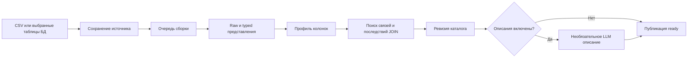

# Данные, источники и каталог

DjedAI превращает набор CSV или выбранные таблицы базы данных в датасет с единым каталогом. Каталог описывает структуру и качество данных, а аналитические инструменты работают с именами таблиц и колонок из этого каталога. Он нужен и пользователю для проверки данных, и агенту для составления вычислений.

Эта глава объясняет путь данных до расчёта, различия источников и смысл показателей каталога. Порядок действий в интерфейсе описан в [руководстве пользователя](../user/user-guide.md), вычисления — в [аналитике](analytics.md), настройки и лимиты — в [конфигурации](../configuration.md).

## Датасет и его источники

Датасет принадлежит одному пользователю. Он объединяет одну или несколько таблиц, каталог, журнал преобразований и файл DuckDB. Чат и дашборд выбирают датасет явно. Таблицы другого датасета, включая датасет того же владельца, в этот аналитический контекст не входят.

| Источник | Где находятся строки при расчёте | Когда видны изменения источника |
| --- | --- | --- |
| CSV | В локальном файле DuckDB датасета | После новой загрузки либо перепрофилировки сохранённых файлов |
| PostgreSQL | В PostgreSQL; DuckDB читает через read-only представления | При новом чтении, в рамках правил снимка хода |
| ClickHouse | Выбранные таблицы скопированы в DuckDB | После явной перепрофилировки с повторной выгрузкой |

ClickHouse в текущей реализации материализуется с ограничением объёма. SQL агента выполняется в DuckDB для всех трёх источников. Живого SQL pushdown в ClickHouse нет. Причины выбора и гарантии полноты выгрузки закреплены в [решении о ClickHouse](../decisions/61-clickhouse.md).

## Жизненный цикл



HTTP-приём возвращает `dataset_id` и `status="processing"`, пока сборка продолжается в фоне. События прогресса и карточка датасета показывают результат: `ready` или `error`. Каталог публикуется после успешной сборки всех таблиц. Ошибка одного файла или выбранной таблицы отклоняет всю первичную сборку; частичный каталог не выдаётся за готовый.

Сервис сохраняет собственную копию CSV до возврата из приёма: `<DATASETS_DATA_DIR>/<dataset_id>/raw/0000.csv`, `0001.csv` и далее по порядку загрузки. Имя исходного файла остаётся метаданными и не задаёт путь. Для базы он сохраняет зашифрованные параметры источника и выбор таблиц. Это позволяет восстановить прерванную сборку после перезапуска. Число одновременных сборок, очереди, загрузки и квоту владельца ограничивает backend; точные параметры — в [конфигурации](../configuration.md).

Единая точка входа для backend — `DatasetService`: `ingest_csv`, `ingest_uploads`, `connect_db`, `get_catalog`, `get_context`, `refresh`, `check_freshness`. Прямой Python-интерфейс и соответствие HTTP описаны в [контракте блока данных](../decisions/62-data-interface.md). Реализация разделена между [фасадом backend](../../src/djedai/backend/dataset_service.py) и [пайплайнами данных](../../src/djedai/data/service.py).

## CSV: от исходных строк до typed view

### Чтение файла

CSV-адаптер определяет кодировку, разделитель, кавычки и наличие заголовка по образцу. Поддержаны разделители `,`, `;`, табуляция и `|`; сначала проверяются UTF-8/BOM, затем подходящие кодировки, включая распространённые русскоязычные выгрузки. Определение формата эвристическое: спорный файл полезно заранее привести к UTF-8 с явным заголовком. Низкоуровневый Python-адаптер дополнительно допускает явный `header=`.

Каждый файл сначала попадает в `raw_<имя>` со строковыми колонками `VARCHAR`. Так сохраняются ведущие нули и исходные значения. Пустое поле без кавычек становится `NULL`, поле `""` — пустой строкой. Для профиля пропусков текст из одних пробелов также считается пустым.

Имена исходных колонок сохраняются. Для SQL создаются нормализованные имена: латиница, `snake_case`, транслитерация кириллицы, суффиксы `_2`, `_3` при совпадениях. Например, «Сумма заказа» становится `summa_zakaza`. Имена таблиц и колонок для запроса нужно брать из каталога, а не угадывать по имени файла. Метаданные файла включают исходное имя, диалект, кодировку, размер и SHA-256.

Исходный слой не редактируется при типизации. Аналитические запросы получают публичное представление без `raw_`, а доступ к raw и служебным реестрам через инструменты запрещён. Реализация чтения — [csv_ingest.py](../../src/djedai/data/csv_ingest.py).

### Выбор типа

Typed view задаёт SQL-преобразование поверх raw. Одно и то же выражение используется для проверки распознавания и для самого представления: журнал и последующие запросы опираются на одинаковое правило.

Колонка получает тип, если распознана доля не ниже `TYPE_PARSE_THRESHOLD`, по умолчанию **0.95 среди непустых значений**. Сравнение на границе выполняется через `Decimal`. Если распознано ровно95 из100 непустых значений, порог достигнут; при94 из100 колонка остаётся текстом. Нераспознанные значения в типизированной колонке становятся `NULL` и отдельно фиксируются как потери разбора.

| Исходное значение или признак | Поведение |
| --- | --- |
| `00123` | Сохраняется как текстовый ID, ведущие нули не теряются |
| Целые в колонке с ID-подобным именем | Сохраняются как текстовый ID |
| `1 234,50` | Может быть распознано как число с десятичной запятой |
| `1 234,50 ₽`, `12.50 USD` | Деньги с валютой, если формат и валюта согласованы |
| Заголовок «Цена, руб.» и обычные числа | Валюта может быть взята из единицы в заголовке |
| `15%` | Число15 с семантическим типом `percent`; автоматического деления на100 нет |
| `да`/`нет`, `true`/`false`, `yes`/`no` | Булев тип при достаточной доле распознавания |
| Даты и время поддержанного формата | `DATE` либо `TIMESTAMP`; выбранный формат остаётся в журнале |

Деньги и проценты используют `DECIMAL(18,s)` с ограничением масштаба до8 знаков; обычные целые — `BIGINT`, дробные — `DOUBLE`. В каталоге физический тип отделён от смыслового: `money`, `percent`, `id`, `date`, `datetime` и т. д. Значения `15%` и `0.15` в одной колонке требуют внимания: система не может по ним доказать единый масштаб.

При профилировании смысловой тип текстовой колонки уточняется по имени и кардинальности. ID-подобное имя имеет приоритет и даёт `id`; иначе `category` назначается при числе различных непустых значений от 1 до `CATEGORY_MAX_DISTINCT` (50) и их доле не больше `CATEGORY_MAX_RATIO` (0.5). Уникальный справочник имён не становится категорией по одному малому числу строк. Физическое представление текста остаётся `VARCHAR`; это уточнение каталога, не преобразование текста в числа.

Неоднозначные даты и числа также не становятся безусловным бизнес-фактом. Например, `01/02/2026` может означать1 февраля или2 января, а `1,234` — десятичную дробь либо запись с разделителем тысяч. Решение и альтернативы сохраняются в журнале; расчёт по такой колонке может потребовать уточнения. Правила находятся в [typed_views.py](../../src/djedai/data/typed_views.py), последствия для ответа — ниже и в [решении о потерях типизации](../decisions/168-typing-losses.md).

## Что содержит каталог

`DatasetCatalog` — общий типизированный контракт данных. Полная JSON-форма используется интерфейсом и backend. Компактная `to_prompt()` передаёт агенту таблицы, колонки, роли, ключи, связи и ограничения, без выборок и top-values. Перед сетью она дополнительно проходит [политику передачи данных](agent.md#передача-данных-модели).

| Уровень | Основные сведения |
| --- | --- |
| Датасет | ID, имя, вид источника, дата создания, ревизия, summary, предупреждения |
| Таблица | SQL-имя и исходное имя, источник, число строк, дубли, возможные ключи, временные колонки |
| Колонка | Исходное/SQL-имя, физический и семантический тип, роль, пропуски, distinct, уникальность, статистики, результат разбора, валюта, описание |
| Связи | Направление, пары колонок, кратность, overlap/Jaccard и confidence |
| Преобразования | Переименования, выбранный формат и тип, причины сохранения текста, потери и примеры |

Профайлер считает точное число строк, исходные пропуски, distinct, top10 значений и до5 примеров. Для чисел есть min/max/mean/median/std, для дат — диапазон и наблюдаемая детализация. Профильное `std` — выборочное стандартное отклонение; аналитическая агрегация `stddev` использует `STDDEV_POP`, поэтому значения могут различаться.

Числовой профиль старается сохранить точность больших целых и `DECIMAL`: суммы и центральные значения считаются в расширенном точном типе, а стандартное отклонение — по отклонениям от минимума. Контракт JSON всё равно имеет собственные числовые ограничения; профиль не заменяет точный финансовый расчёт подтверждённой метрики.

`null_ratio` относится к исходным пустым значениям. Потери разбора учитываются отдельно через `parse.success_ratio` и журнал. Поэтому `NULL` typed view не всегда означает, что исходная ячейка была пустой. Полный дубль профиля сравнивает исходные строки; число `duplicate_rows` — лишние копии сверх уникальных строк. Аналитический `find_duplicates` по typed колонкам имеет другую популяцию и отдельно показывает все строки групп дублей.

Кандидат ключа и `is_unique` описывают наблюдаемые данные. Это ещё не ограничение, наложенное в исходной БД. Профиль таблицы строится в одной транзакции, но профилирование нескольких таблиц не обещает единого исторического снимка всего источника.

Контракт — [catalog.py](../../src/djedai/contracts/catalog.py), сборка — [catalog_builder.py](../../src/djedai/data/catalog_builder.py), вычисления профиля — [profiler.py](../../src/djedai/data/profiler.py).

## Поиск связей и риск JOIN

Все три штатных пайплайна после профилирования вызывают поиск связей. Алгоритм рассматривает ID-подобные и подходящие уникальные колонки с совместимыми семействами типов и минимум двумя distinct-значениями. Для разных таблиц используется общий поиск; внутри одной таблицы допускается самоссылка, если одна колонка — подходящий уникальный ID-ключ, а имя второй указывает на ссылку на него, например «Код исходной позиции» → «Код позиции». Произвольные похожие колонки одной таблицы связью не объявляются. Непустые значения сравниваются точно; обрезка пробелов, склейка нескольких ключей и нечёткое сопоставление не выполняются.

Для множеств ключей `A` и `B`:

```text
intersection = |A ∩ B|
jaccard      = |A ∩ B| / |A ∪ B|
overlap      = intersection / |источник|
```

У `N:M` знаменатель overlap — меньшая из двух distinct-мощностей. Уникальная сторона становится целевой стороной `N:1`; при двух уникальных сторонах получается `1:1`, при двух неуникальных — `N:M`.

При согласованных именах достаточно overlap>=0.5. Без совпадения имён принимаются только не-`N:M` связи с overlap>=0.95 и Jaccard>=0.5. Сейчас эти пороги задают константы [relations.py](../../src/djedai/data/relations.py); одноимённые `RELATION_*` settings не управляют алгоритмом.

Для принятой связи рассчитывается JOIN impact: сколько строк даст LEFT/INNER JOIN, есть ли строки без пары, пустые ключи, размножение и изменение сумм числовых полей исходной стороны. `high` требует согласованных имён, overlap>=0.95 и отсутствия unmatched/размножения; связи без совпавших имён, `N:M` и размножающие связи имеют `low`. NULL учитываются отдельно.

Например, одна строка заказа после соединения с тремя позициями встречается три раза. `SUM(orders.amount)` по такому результату завышает сумму заказа. Связь и её confidence помогают заметить риск; подтверждённые метрики дополнительно проверяют сохранение grain при расчёте. Подробнее — [бизнес-метрики](analytics.md#подтверждённые-бизнес-метрики).

Обнаруженная связь остаётся выводом по данным, а не доказательством бизнес-смысла. Для произвольного SQL общего семантического доказательства корректности любого JOIN нет.

## Описания с помощью модели

При `CATALOG_DESCRIPTIONS=true` backend добавляет описания перед публикацией новой ревизии для CSV, PostgreSQL и ClickHouse. По умолчанию функция выключена. Ошибка, timeout или отсутствие модели оставляют статистический каталог рабочим и добавляют предупреждение.

Описания запрашиваются порциями до20 колонок, затем формируется summary датасета. Заполняются пустые поля, существующие описания не перезаписываются. Проверяются имена колонок, наличие кириллицы и длина: до200 символов для описания, до400 для summary. Подсказки модели не меняют типы, статистики, связи и подтверждённые определения метрик.

Принятые полные ответы кэшируются в `_djedai_descriptions`. Ключ зависит от модели, prompt, схемы ответа и очищенного входного JSON. Неполный ответ не кэшируется; его корректная часть может быть использована в текущем каталоге. При недоступной модели дальнейшие вызовы прекращаются. Новый файл ревизии получает собственный кэш.

Примеры и частые значения каталога передаются только при разрешении общей политики; `share_values=False` дополнительно запрещает их. Даже без примеров внешняя модель получает разрешённые метаданные и агрегаты. Получатель и разрешение берутся из одного снимка настроек модели. Реализация — [descriptions.py](../../src/djedai/data/descriptions.py) и `DatasetService._describe`.

## PostgreSQL: живое чтение

Подключение создаёт read-only raw/typed views через расширение `postgres` DuckDB. Типы опираются на схему БД; авторазбор CSV к этим значениям не применяется. `DECIMAL` сам по себе не означает деньги, UUID представляется строковым ID, значения со временем/зоной приводятся к согласованному представлению UTC без зоны. Неподдержанные типы переводятся в текст с записью преобразования.

Каждое аналитическое окружение имеет собственный in-memory DuckDB context, read-only файл датасета и собственное подключение источника. Соседний запрос не отсоединяет общий `pg_src`. DSN не записывается в DuckDB или каталог: backend хранит Fernet ciphertext, связанный с владельцем и датасетом. Для восстановления подключения после перезапуска нужен прежний `SOURCE_ENCRYPTION_KEY`.

На стороне PostgreSQL требуется роль с правами только чтения. Локальная SQL-защита и read-only ATTACH дополняют эту роль. Первая установка расширения DuckDB может потребовать сетевой доступ. Синтаксис DSN, setup роли и эксплуатация описаны в [локальном запуске](../administrator/local-build.md), [операциях](../administrator/operations.md) и [postgres.py](../../src/djedai/data/postgres.py).

## ClickHouse: ограниченный снимок

Адаптер использует HTTP-интерфейс ClickHouse и Parquet. Он выгружает выбранные таблицы в файл датасета, строит typed views, профиль и связи. После публикации аналитике не нужны секрет и сетевое соединение с ClickHouse.

По умолчанию допускается суммарно до10000000 строк и1000000000 байт выбранных таблиц, таймаут запроса300с. Это предел источника и выгрузки, а не обещанный размер памяти процесса или итогового DuckDB-файла. Проверки выполняются до чтения, во время потоковой выгрузки и после подсчёта загруженных строк. Превышение отклоняет сборку, усечённый результат не публикуется как полный.

Настройки профиля источника проверяются на отсутствие скрытых `limit`/`offset` и режимов `break`, которые могли бы вернуть неполную выгрузку успешным ответом. Нужен read-only пользователь; гарантии задаёт серверная роль. Decimal, даты, время, Nullable и другие поддержанные типы проходят через Parquet; сложные/слишком широкие типы могут стать текстом с журналом. Детали — [ClickHouse adapter](../../src/djedai/data/clickhouse.py) и [решение о материализации](../decisions/61-clickhouse.md).

## Ревизия, свежесть и перепрофилировка

Каталог — профиль на определённый момент. `CatalogRevision` включает возрастающий `number`, `profiled_at`, `schema_fingerprint`, `source_fingerprint` и `transform_version`. Отпечаток источника не содержит пароль и не раскрывает адрес в открытом виде. Старый каталог без ревизии поддерживается с состоянием `unknown`.

Для PostgreSQL перед чтением схема сравнивается с сохранённой:

| Свежесть | Значение | Расчёт |
| --- | --- | --- |
| `fresh` | Схема совпала, профиль достаточно свежий | Разрешён |
| `aged` | Схема совпала, возраст профиля выше24ч по умолчанию | Разрешён с ограничением о статистике каталога |
| `drifted` | Добавлены совместимые колонки | Разрешён по прежним колонкам, новые появятся после refresh |
| `incompatible` | Удалена таблица/колонка либо изменён тип | Остановлен с409 `catalog_stale` |
| `unknown` | У старого каталога нет сохранённой ревизии/схемы | Разрешён с явной границей знания |

CSV и ClickHouse считаются свежими относительно собственного неизменяемого снимка. Это не означает, что внешняя ClickHouse с тех пор не изменилась. Проверка свежести не пересчитывает каталог и не сравнивает все значения данных.

Явный refresh заново строит каталог из сохранённого источника. Пока новая ревизия собирается, датасет остаётся `ready`, старые чаты продолжают читать согласованную старую пару «каталог + файл». Новая ревизия строится в отдельном `.building.duckdb`, затем файл и каталог публикуются вместе. При ошибке старая ревизия остаётся доступна, а ошибка видна в `refresh`.

Файлы разных ревизий имеют разные пути: `dataset.duckdb`, затем `dataset.r<N>.duckdb`. Сохраняются текущая и предыдущая ревизии; это не архив всех каталогов. Подтверждённые метрики сверяются с новым каталогом при использовании, исчезнувшие поля дают `metric_definition_stale`. Автоматической перепрофилировки по расписанию или drift нет.

Точная модель — [решение о ревизии](../decisions/169-catalog-revision.md), [fingerprint.py](../../src/djedai/data/fingerprint.py) и [source_reads.py](../../src/djedai/backend/source_reads.py).

## По каким данным получен конкретный результат

Новый `ToolResult.read` хранит ревизию, отпечатки, версию типизации, время чтения, режим и согласованность:

- `read_mode="snapshot"` — локальный снимок CSV/ClickHouse;
- `read_mode="live"` — чтение PostgreSQL;
- `unknown` — у старой записи сведений недостаточно.

Контракт также допускает `saved_result`, однако текущий `SourceReader` назначает `live`/`snapshot` по виду датасета и зависимым шагам. Связь дочернего расчёта с родительским результатом фактически определяется через `source_result_id` и рецепт; одно значение `read_mode` её не доказывает.

В PostgreSQL запросы одного хода используют общий снимок `REPEATABLE READ` через транзакцию DuckDB: `consistency="turn_snapshot"`. Ошибка или timeout может прервать транзакцию; следующий инструмент откроет новый `snapshot_id`. Разные снимки в одном ответе становятся явным ограничением. Для CSV/ClickHouse согласованность `immutable`, snapshot ID соответствует ревизии. Dashboard refresh также объединяет чтения через `SourceReader.share_snapshot`; при потере общего снимка показывает `independent`.

Повторное открытие результата читает сохранённый Parquet/preview, а не заново выполняет SQL. Поэтому старый результат PostgreSQL может отличаться от нового расчёта после изменения источника. Его `read` объясняет происхождение, но система не хранит историческую копию всей PostgreSQL-базы.

## Как качество преобразования влияет на ответ

Профиль таблицы показывает общую картину, а `ToolResult.quality` относится к колонкам конкретного расчёта. Для меры, фильтра, группировки и вывода подсчитываются исходные пропуски и потери разбора в популяции SQL после JOIN/WHERE. Для ключа JOIN или неподдержанной конструкции используется профиль таблицы с явным `boundary`. Число потерь по всей таблице не выдаётся за точное число потерь фильтрованной выборки.

Любая потеря значения меры даёт warning. Неоднозначная дата в вычислении и смешанные валюты в агрегате могут блокировать ответ до уточнения. Варианты уточнения относятся к текущему вопросу; они не меняют сохранённый формат столбца. В ответе детерминированно добавляется блок «Ограничения данных», а происхождение чтения попадает в «Как посчитано».

Например, если из100 непустых сумм четыре не распознаны, колонка проходит порог95%, но `SUM` пропускает эти четыре значения. Правильная интерпретация результата — сумма распознанных значений с предупреждением о потерях. Подробнее о lineage, популяции, кодах и блокировках — [качество вычислений](analytics.md#качество-колонок-расчёта).

## Где смотреть реализацию и проверки

- [data/service.py](../../src/djedai/data/service.py) — три пайплайна и ревизия;
- [backend/dataset_service.py](../../src/djedai/backend/dataset_service.py) — очередь, публикация, refresh, владелец и восстановление;
- [contracts/catalog.py](../../src/djedai/contracts/catalog.py), [contracts/freshness.py](../../src/djedai/contracts/freshness.py) — публичные типы;
- [tests/unit/data](../../tests/unit/data) — чтение, типизация, профиль, связи, описания и отпечатки;
- [test_catalog_revision.py](../../tests/integration/test_catalog_revision.py), [test_data_interface.py](../../tests/integration/test_data_interface.py) — согласованность и фасад;
- [test_quality_api.py](../../tests/integration/test_quality_api.py) — ограничения результата и их сохранение.

Описание тестового пути и пределов доказательства находится в [качестве и проверках](quality.md).
