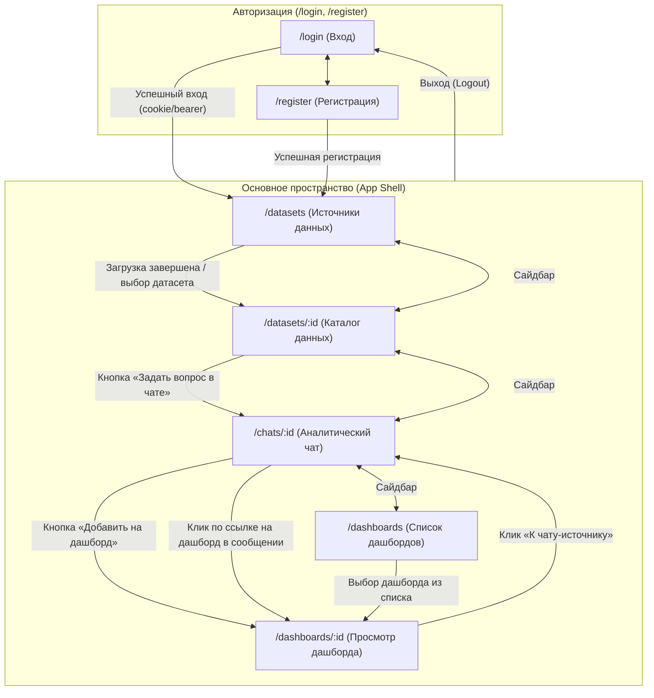

# DjedAI — Схемы экранов, маршруты и пользовательские сценарии (B4-0)

Данный документ фиксирует структуру пользовательского интерфейса платформы DjedAI на базе **React + TypeScript** (`frontend/`), карту маршрутов, правила прямого перехода по ссылкам (Deep Linking), поведение при обновлении страницы (Reload/F5), вайрфреймы экранов, матрицу состояний (ожидание, отсутствие данных, ошибка) и сквозной пользовательский путь от авторизации до создания живого дашборда.

Документ согласован с требованиями бизнес-аналитики (DA) и служит основой для реализации каркаса приложения в задаче [B4-1 / #83](https://github.com/Polozhentsev-Ivan/DjedAI/issues/83).

---

## 1. Карта навигации и маршруты React-приложения

Интерфейс строится по схеме Single Page Application (SPA) с постоянным базовым каркасом (Shell), включающим боковую панель навигации (Sidebar) и верхнюю панель (TopBar) с контекстом активного датасета и профилем пользователя.

### 1.1 Диаграмма переходов (Mermaid)



### 1.2 Таблица маршрутов (React Router)

| Маршрут (URL) | Компонент (`frontend/src/pages/`) | Назначение экрана | Backend API эндпоинты |
|---|---|---|---|
| `/login` | `LoginPage` | Вход в систему, ввод логина и пароля | `POST /api/auth/login` |
| `/register` | `RegisterPage` | Регистрация нового локального пользователя | `POST /api/auth/register` |
| `/datasets` | `DatasetsPage` | Список датасетов, загрузка CSV, подключение PostgreSQL / ClickHouse | `GET /api/datasets`<br>`POST /api/datasets/upload`<br>`POST /api/datasets/connect` |
| `/datasets/:id` | `CatalogPage` | Каталог таблиц и колонок, типы, пропуски, связи и журнал трансформаций | `GET /api/datasets/{id}`<br>`GET /api/datasets/{id}/events` (SSE прогресса) |
| `/chats` | `ChatPage` (новый диалог) | Стартовая страница чата с подсказками к активному датасету | `GET /api/chats?dataset_id=`<br>`POST /api/chats` |
| `/chats/:id` | `ChatPage` | Диалог с агентом, стриминг шагов, графики ECharts, «Как посчитано» | `GET /api/chats/{id}`<br>`POST /api/chats/{id}/messages` (SSE)<br>`GET /api/results/{id}/data` |
| `/dashboards` | `DashboardsPage` | Список сохранённых дашбордов текущего датасета | `GET /api/dashboards?dataset_id=` |
| `/dashboards/:id` | `DashboardViewPage` | Сетка аналитических виджетов, ручной пересчёт данных («Обновить») | `GET /api/dashboards/{id}`<br>`POST /api/dashboards/{id}/refresh`<br>`GET /api/results/{id}/data` |

---

## 2. Прямое открытие ссылок (Deep Linking) и обновление страницы (Reload / F5)

### 2.1 Прямой переход по ссылке (Deep Linking)

Пользователь может открыть прямую ссылку на конкретный экран (например, закладка в браузере или ссылка от коллеги: `http://localhost:5173/dashboards/d_42` или `/chats/c_15`).

Порядок обработки в React-приложении:
1. **Проверка аутентификации (`AuthProvider`):**
   - Клиент запрашивает профиль текущего пользователя: `GET /api/auth/me`.
   - Если получен статус `401 Unauthorized`:
     - Текущий целевой путь сохраняется в URL параметра: `/login?redirect=%2Fdashboards%2Fd_42`.
     - Пользователь видит экран входа с информационным сообщением *«Для просмотра ресурса войдите в систему»*.
     - После успешной авторизации происходит автоматический переход на исходный URL из `redirect`.
2. **Загрузка данных сущности:**
   - Если пользователь авторизован, страница переходит в состояние ожидания (скелетон сетки виджетов или чата).
   - Отправляется запрос за сущностью: `GET /api/dashboards/d_42` (или `GET /api/chats/c_15`).
   - Если сущность не найдена (404) или у пользователя нет к ней доступа (403):
     - Отображается экран `404 Not Found` с понятной плашкой: *«Дашборд d_42 не найден или был удалён»* и кнопкой *«Вернуться к списку дашбордов»*.
3. **Синхронизация контекста активного датасета:**
   - После успешного получения сущности активный датасет в глобальном контексте и селекторе TopBar автоматически переключается на `dataset_id`, к которому привязана открытая сущность.

### 2.2 Обновление страницы (Page Refresh / F5)

1. **URL как единый источник правды (Single Source of Truth):**
   - Все ключевые идентификаторы (`dataset_id`, `chat_id`, `dashboard_id`) хранятся в URL-маршруте, а не только в памяти React (Redux/Zustand). При обновлении F5 открывается именно тот экран и ресурс, на котором находился пользователь.
2. **Идемпотентность и защита от повторных POST-запросов:**
   - Обновление страницы выполняет только `GET`-запросы для восстановления интерфейса.
   - Пользовательский промпт в чате или отправка формы подключения БД не переотправляются повторно на бэкенд.
3. **Поведение при обновлении страницы во время активного SSE-стриминга:**
   - Если пользователь нажал F5 во время стриминга ответа агента (`POST /api/chats/:id/messages`):
     - Браузер разрывает активное соединение `fetch / ReadableStream`.
     - На сервере процесс выполнения шагов либо завершается корректно с сохранением результата в БД, либо останавливается по отмене контекста.
     - При повторной загрузке страницы компонент `ChatPage` запрашивает актуальную историю: `GET /api/chats/:id`.
     - Если агент успел сохранить результат в историю сообщений, пользователь сразу видит готовый ответ. Если ответ был прерван на середине, чат отображает последнее успешно сохранённое сообщение и плашку *«Генерация была прервана. Вы можете повторить запрос»*.
4. **Сохранение черновиков:**
   - Неотправленный текст вопроса в строке ввода чата сохраняется в `sessionStorage` по ключу `draft_chat_{id}` и восстанавливается после перезагрузки страницы.

---

## 3. Сквозной путь пользователя (User Journey)

| Шаг | Экран и URL | Действие пользователя | Визуальный отклик и реакция системы | Задействованный контракт / API |
|---|---|---|---|---|
| **1. Вход** | Вход<br>`/login` | Вводит логин/пароль, нажимает «Войти» | Спиннер на кнопке → успешная авторизация → редирект на экран источников | `POST /api/auth/login`<br>→ session cookie / token |
| **2. Загрузка** | Источники<br>`/datasets` | Перетаскивает CSV-файлы в зону Drag&Drop | Появление прогресс-бара с фазами обработки: *«Чтение → Типизация → Профилирование»* (SSE) | `POST /api/datasets/upload`<br>`GET /api/datasets/{id}/events` |
| **3. Каталог** | Каталог<br>`/datasets/:id` | Изучает карточки таблиц, типизацию, пропуски и выявленные связи | Отображение бизнес-названий и системных имен колонок, предупреждений трансформаций | `GET /api/datasets/{id}`<br>Контракт: `DatasetCatalog` |
| **4. Вопрос** | Чат<br>`/chats/:id` | Пишет вопрос: *«Покажи динамику выручки по месяцам»* | Потоковый вывод шагов агента: *«[⟳] Анализирую структуру... Считаю агрегаты...»* | `POST /api/chats/{id}/messages`<br>SSE события: `status`, `block` |
| **5. Результат** | Чат<br>`/chats/:id` | Просматривает ответ: текст с цифрами + график ECharts | График интерактивен (тултипы, зум); доступна панель **«Как посчитано»** с SQL | `GET /api/results/{id}/data`<br>Контракты: `ChartSpec`, `ToolResult` |
| **6. Сохранение**| Чат<br>`/chats/:id` | Нажимает кнопку **«Добавить на дашборд»** на графике | Модальное окно выбора/создания дашборда → плашка со ссылкой `[Перейти к дашборду ->]` | `POST /api/dashboards`<br>Контракт: `Dashboard` |
| **7. Дашборд** | Дашборды<br>`/dashboards/:id` | Открывает дашборд, нажимает **«Обновить данные (⟳)»** | Фоновый независимый пересчёт виджетов (индивидуальные спиннеры); графики обновляются | `POST /api/dashboards/{id}/refresh`<br>Контракт: `Dashboard` |

---

## 4. Вайрфреймы экранов

### Экран 1: Регистрация и Вход (Auth — `/login`, `/register`)

```text
+-----------------------------------------------------------------------+
|                              DjedAI                                   |
|               Локальная аналитическая платформа                       |
|                                                                       |
|             +---------------------------------------+                 |
|             |          [Вход]  /   Регистрация      |                 |
|             |                                       |                 |
|             |  Имя пользователя / Email:            |                 |
|             |  [ user@company.local               ] |                 |
|             |                                       |                 |
|             |  Пароль:                              |                 |
|             |  [ ********************             ] |                 |
|             |                                       |                 |
|             |  [          Войти в систему         ] |                 |
|             |                                       |                 |
|             |  Нет аккаунта? Зарегистрироваться     |                 |
|             +---------------------------------------+                 |
+-----------------------------------------------------------------------+
```

---

### Экран 2: Источники данных (Data Sources — `/datasets`)

```text
+-----------------------------------------------------------------------------------+
| DjedAI | Активный датасет: [ orders_2026 v ]        | Пользователь: ivan (Выйти)  |
+--------------+--------------------------------------------------------------------+
| [Навигация]  | Источники данных                                                   |
|              |                                                                    |
| • Источники* | +-- [Загрузить CSV] ---------------- [Подключить БД] ------------+ |
| • Каталог    | |                                                                | |
| • Чат        | |      +---------------------------------------------------+     | |
| • Дашборды   | |      |       Перетащите CSV файлы сюда или [Обзор]       |     | |
|              | |      |       Поддерживаются: UTF-8, CP1251, запятая/;/tab|     | |
|              | |      +---------------------------------------------------+     | |
|              | +----------------------------------------------------------------+ |
|              |                                                                    |
|              | Ваши датасеты:                                                     |
|              | +--------------------+---------+----------+----------+-----------+ |
|              | | Название           | Источник| Таблиц   | Строк    | Статус    | |
|              | +--------------------+---------+----------+----------+-----------+ |
|              | | orders_2026 (акт.) | CSV (2) | 2        | 120 450  | [Готов]   | |
|              | | retail_crm_prod    | Postgres| 5        | 1 420 000| [Готов]   | |
|              | | marketing_q3       | CSV (1) | -        | -        | [Ошибки]  | |
|              | +--------------------+---------+----------+----------+-----------+ |
|              | [ Выбрать для анализа ]  [ Посмотреть каталог ]  [ Удалить ]       |
+--------------+--------------------------------------------------------------------+
```

---

### Экран 3: Каталог данных (Data Catalog — `/datasets/:id`)

```text
+-----------------------------------------------------------------------------------+
| DjedAI | Активный датасет: [ orders_2026 v ]        | Пользователь: ivan (Выйти)  |
+--------------+--------------------------------------------------------------------+
| [Навигация]  | Каталог датасета: orders_2026         [ Задать вопрос в чате -> ]  |
|              |                                                                    |
| • Источники  | Таблицы: (•) orders (120 000 строк)   ( ) customers (450 строк)    |
| • Каталог*   |                                                                    |
| • Чат        | Структура таблицы: orders                                          |
| • Дашборды   | +------------------+---------------+------------+---------+------+ |
|              | | Исходное имя     | В системе     | Тип данных | Пропуски| Прим.| |
|              | +------------------+---------------+------------+---------+------+ |
|              | | Номер заказа     | order_id      | text (id)  | 0%      | #    | |
|              | | Дата оплаты      | payment_date  | date       | 0.1%    | d.m.y| |
|              | | Сумма с НДС, руб | amount        | money (₽)  | 0%      | ₽    | |
|              | | Скидка           | discount      | percent (%)| 5.2%    | %    | |
|              | | Статус           | status        | category   | 0%      | 4 зн.| |
|              | +------------------+---------------+------------+---------+------+ |
|              |                                                                    |
|              | Журнал обработки данных (Трансформации):                           |
|              | [i] В колонке «Сумма с НДС, руб» распознан формат валюты (₽).      |
|              | [!] В колонке «Дата оплаты» 12 строк содержали нераспознанный      |
|              |     текст; заменены на NULL. Исходные значения сохранены в raw.    |
|              |                                                                    |
|              | Обнаруженные связи таблиц:                                         |
|              | orders.customer_id <---> customers.id (уверенность: 99.8%)         |
+--------------+--------------------------------------------------------------------+
```

---

### Экран 4: Аналитический Чат (Chat — `/chats/:id`)

```text
+-----------------------------------------------------------------------------------+
| DjedAI | Активный датасет: [ orders_2026 v ]        | Пользователь: ivan (Выйти)  |
+--------------+--------------------------------------------------------------------+
| [История]    | Чат: Анализ продаж                                                 |
|              |                                                                    |
| [+ Новый чат]| Пользователь:                                                      |
|              | > Покажи динамику выручки по месяцам за 2026 год.                  |
| • Продажи Q1 |                                                                    |
| • Регионы    | Ассистент DjedAI:                                                  |
| • Сегменты   | [i] Выручка стабильно растет: максимальный пик зафиксирован        |
|              |     в июле (3.4 млн ₽, +34% к среднему уровню).                    |
|              |                                                                    |
|              | +----------------------------------------------------------------+ |
|              | | [График: Выручка по месяцам, ₽]         [+ В дашборд] [Экспорт]| |
|              | | 4M |                      /\                                   | |
|              | | 2M |           /\        /  \     /\                           | |
|              | |  0 | _/\______/  \______/    \___/  \______                    | |
|              | |      Янв Фев Мар Апр Май Июн Июл Авг Сен Окт                   | |
|              | +----------------------------------------------------------------+ |
|              |                                                                    |
|              | [v] Как посчитано:                                                 |
|              |     Инструмент: time_aggregate(table='orders', freq='month')       |
|              |     SQL: SELECT date_trunc('month', payment_date) AS month,        |
|              |                 sum(amount) AS total_amount                        |
|              |          FROM orders GROUP BY 1 ORDER BY 1                         |
|              |                                                                    |
|              | Подсказки для следующего шага:                                     |
|              | [Сравнить с прошлым годом] [Разбить по регионам] [Топ-10 клиентов] |
|              |--------------------------------------------------------------------|
|              | [ Введите вопрос к данным (например: «Где больше возвратов?»)]     |
|              |                                                       [ Отправить ]|
+--------------+--------------------------------------------------------------------+
```

---

### Экран 5: Дашборды (Dashboards — `/dashboards`, `/dashboards/:id`)

```text
+-----------------------------------------------------------------------------------+
| DjedAI | Активный датасет: [ orders_2026 v ]        | Пользователь: ivan (Выйти)  |
+--------------+--------------------------------------------------------------------+
| [Навигация]  | Дашборд: Квартальная статистика продаж                             |
|              | Описание: Сформирован по результатам диалога в чате                |
| • Источники  | Последнее обновление: 18.10.2026 14:00   [ Обновить данные (⟳) ]  |
| • Каталог    |                                                                    |
| • Чат        | +--------------------------------+-------------------------------+ |
| • Дашборды*  | | Виджет 1: Выручка по месяцам   | Виджет 2: Доля по регионам    | |
|              | | [ Линейный график ECharts ]    | [ Круговая диаграмма ECharts] | |
|              | | Пик продаж — июль              | Москва: 45%, СПБ: 25%         | |
|              | | [Как посчитано]      [Удалить] | [Как посчитано]      [Удалить]| |
|              | +--------------------------------+-------------------------------+ |
|              | | Виджет 3: Топ категорий        | Виджет 4: KPI Квартала        | |
|              | | [ Столбчатая диаграмма ECharts]| 12.4 млн ₽                    | |
|              | | Электроника лидирует           | (+18% к цели)                 | |
|              | | [Как посчитано]      [Удалить] | [Как посчитано]      [Удалить]| |
|              | +--------------------------------+-------------------------------+ |
+--------------+--------------------------------------------------------------------+
```

---

## 5. Матрица состояний экранов

Для каждого экрана предусмотрены обязательные состояния: **Штатное (Ready)**, **Ожидание (Loading)**, **Отсутствие данных (Empty State)** и **Ошибка (Error State)**.

| Экран | Состояние ожидания (Loading) | Отсутствие данных (Empty State) | Состояние ошибки (Error State) |
|---|---|---|---|
| **Регистрация / Вход**<br>`/login`, `/register` | Спиннер внутри кнопки отправки формы, поля блокируются от повторного ввода (`disabled`). | Форма пуста: фокус в первом поле, валидация формата email/пароля на клиенте при потере фокуса. | Красный баннер: *«Неверный логин или пароль»* / *«Пользователь с таким именем уже существует»*. Поля подсвечиваются. |
| **Источники**<br>`/datasets` | Многостадийный прогресс-бар профилирования (SSE): *«1. Чтение файла... 2. Распознавание типов... 3. Профилирование...»*. | Плашка онбординга: *«У вас пока нет загруженных данных. Перетащите CSV-файл или подключите тестовую базу данных»* + кнопка *«Загрузить демо-данные»*. | Файл не разобран: *«Файл sales.csv: не удалось разобрать строку 42 (ожидалось 5 колонок, получено 3)»* + кнопка *«Загрузить заново»*. |
| **Каталог**<br>`/datasets/:id` | Скелетонная загрузка карточек таблиц, списка атрибутов и визуального графа связей. | Датасет пуст или не содержит доступных таблиц: плашка *«В датасете нет готовых таблиц. Вернитесь в источники для повторной обработки»*. | *«Не удалось загрузить каталог датасета: ошибка чтения метаданных DuckDB»* + кнопка *«Повторить запрос»*. |
| **Чат**<br>`/chats/:id` | Потоковый статус шагов агента в реальном времени: *«[⟳] Анализирую вопрос...»* → *«[⟳] Формирую SQL...»* → *«[⟳] Строю визуализацию...»*. | Приветственный экран: заголовок *«Чем я могу помочь по датасету orders_2026?»* + кликабельные карточки с типовыми вопросами к данным. | • *Неоднозначный вопрос:* интерактивный блок уточнения с кнопками вариантов ответа.<br>• *Таймаут выполнения:* *«Запрос выполнялся дольше 30 сек. Попробуйте сузить диапазон дат»* + подсказка к повтору. |
| **Дашборды**<br>`/dashboards`, `/dashboards/:id` | При открытии — скелетон сетки виджетов. При нажатии «Обновить данные» — индивидуальные индикаторы обновления на каждом виджете. | Список дашбордов пуст: *«У вас еще нет сохраненных дашбордов. Задайте вопрос в чате и нажмите "Добавить на дашборд" под графиком»*. | Ошибка пересчёта изолирована на уровне сбойного виджета: остальные виджеты отображаются нормально, на сбойном — плашка *«Не удалось обновить: [Повторить]»*. |

---

## 6. Проверка понятности с точки зрения аналитики (DA / Business Review)

Схемы и сценарии верифицированы с учетом требований продуктовой понятности и строгости бизнес-аналитики:

1. **Прозрачность вычислений («Как посчитано»):**
   - Под каждым текстовым ответом, таблицей и графиком размещается разворачиваемый блок **«Как посчитано»**.
   - Блок содержит: наименование инструмента (`tool`), примененные параметры (фильтры, группировки, период) и исполненный безопасный SQL-запрос.
2. **Защита от числовых галлюцинаций:**
   - LLM генерирует текстовое резюме строго на основе блока `facts` из контракта `ToolResult`. Любые числовые утверждения опираются на детерминированный расчет.
   - Компонент графиков в TypeScript не получает координаты от LLM: фронтенд запрашивает массив агрегированных точек напрямую через `/api/results/{id}/data` и транслирует `ChartSpec` в ECharts option.
3. **Единые стандарты бизнес-форматирования (RU):**
   - Деньги: неразрывный пробел между тысячами и знак валюты (`1 250 000 ₽`, `$ 45 200`).
   - Проценты: знак плюс для положительной динамики, запятая как разделитель (`+34%`, `-5,2%`, `12,5%`).
   - Даты: локализованный порядок `ДД.ММ.ГГГГ` или текстовое название месяца (`Июль 2026`).
   - Имена колонок: отображение понятных человекочитаемых названий из оригинала (заголовок CSV) рядом с системным идентификатором.
4. **Уточнение вместо ошибки (Clarification UX):**
   - На двусмысленный вопрос (например, *«Покажи продажи»*, если в таблице есть `order_amount` и `paid_amount`) система выдает кнопки с вариантами ответа вместо падения с технической ошибкой.
5. **Живые дашборды (Live Dashboards):**
   - При открытии дашборда и нажатии кнопки «Обновить данные» запускается не статическая перерисовка сохраненных картинок, а актуальный пересчет параметров инструмента (`tool_call`) на свежих данных источника с генерацией новых `result_id`.

---

## 7. Чек-лист проверки сценариев командой (Review Guide)

Для подтверждения критериев приёмки задачи B4-0 рекомендуется провести сквозную проверку по следующим контрольным вопросам:

### 7.1 Проверка пути «регистрация → источник → каталог → вопрос → дашборд»
- [ ] **Регистрация/Вход:** Понятно ли, как пользователь заходит в систему и попадает на экран источников?
- [ ] **Источник:** Понятно ли, куда загружать CSV-файлы и как отображается ход обработки?
- [ ] **Каталог:** Видит ли пользователь структуру данных, типы колонок и журнал предупреждений до того, как начнет задавать вопросы?
- [ ] **Вопрос:** Понятно ли, как выглядит диалог, где отображается стриминг шагов агента и как устроен график?
- [ ] **Дашборд:** Понятно ли, как график из чата сохраняется в виджет дашборда и как его потом обновить?

### 7.2 Проверка действий пользователя в нештатных ситуациях
- [ ] **Ожидание:** Понимает ли пользователь, что система работает (прогресс-бар загрузки, стриминг шагов агента, спиннеры виджетов)?
- [ ] **Пустой результат:** Есть ли на каждом экране подсказка «что делать дальше», если данных нет (онбординг в источниках, карточки-подсказки в чате, ссылка на создание дашборда)?
- [ ] **Ошибка:** Понятны ли пользователю сообщения об ошибках (неправильный пароль, битый CSV, таймаут сложного SQL, сбой отдельного виджета)?
